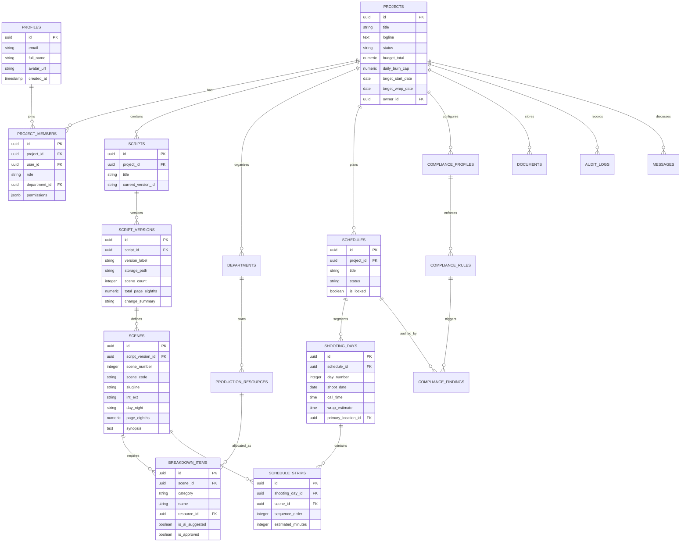

# SceneOS — Database Schema, Relational Integrity & RLS Strategy
**Document Version:** 1.0.0  
**Classification:** Core Database Specification  
**Engine:** PostgreSQL 15+ (Supabase)  

---

## 1. Relational Entity-Relationship Diagram (ERD)



---

## 2. Core Relational Tables & Integrity Constraints

### 2.1 Identity & Governance

#### `public.profiles`
Mirrors Supabase `auth.users` via trigger.
```sql
CREATE TABLE public.profiles (
    id UUID PRIMARY KEY REFERENCES auth.users(id) ON DELETE CASCADE,
    email TEXT NOT NULL UNIQUE,
    full_name TEXT NOT NULL,
    avatar_url TEXT,
    phone TEXT,
    bio TEXT,
    created_at TIMESTAMPTZ NOT NULL DEFAULT timezone('utc'::text, now()),
    updated_at TIMESTAMPTZ NOT NULL DEFAULT timezone('utc'::text, now())
);
```

#### `public.projects`
Core tenant container for every film production.
```sql
CREATE TABLE public.projects (
    id UUID PRIMARY KEY DEFAULT gen_random_uuid(),
    title TEXT NOT NULL CHECK (char_length(trim(title)) > 0),
    logline TEXT,
    director TEXT,
    producer TEXT,
    status TEXT NOT NULL DEFAULT 'development' 
        CHECK (status IN ('development', 'pre-production', 'production', 'post-production', 'wrapped', 'archived')),
    budget_total NUMERIC(14, 2) NOT NULL DEFAULT 0.00 CHECK (budget_total >= 0),
    daily_burn_cap NUMERIC(12, 2) NOT NULL DEFAULT 0.00 CHECK (daily_burn_cap >= 0),
    target_start_date DATE,
    target_wrap_date DATE,
    owner_id UUID NOT NULL REFERENCES public.profiles(id) ON DELETE RESTRICT,
    created_at TIMESTAMPTZ NOT NULL DEFAULT timezone('utc'::text, now()),
    updated_at TIMESTAMPTZ NOT NULL DEFAULT timezone('utc'::text, now()),
    CONSTRAINT valid_dates CHECK (target_wrap_date IS NULL OR target_start_date IS NULL OR target_wrap_date >= target_start_date)
);
```

#### `public.project_members`
RBAC association mapping users to projects with granular roles.
```sql
CREATE TYPE public.project_role AS ENUM (
    'owner',
    'producer',
    'director',
    'first_ad',
    'department_head',
    'crew_member',
    'viewer'
);

CREATE TABLE public.project_members (
    id UUID PRIMARY KEY DEFAULT gen_random_uuid(),
    project_id UUID NOT NULL REFERENCES public.projects(id) ON DELETE CASCADE,
    user_id UUID NOT NULL REFERENCES public.profiles(id) ON DELETE CASCADE,
    role public.project_role NOT NULL DEFAULT 'crew_member',
    department_id UUID, -- References departments table
    custom_permissions JSONB DEFAULT '{}'::jsonb,
    joined_at TIMESTAMPTZ NOT NULL DEFAULT timezone('utc'::text, now()),
    CONSTRAINT unique_project_user UNIQUE (project_id, user_id)
);
```

---

### 2.2 Script, Scene & Breakdown Entities

#### `public.scripts` & `public.script_versions`
Screenplays are versioned immutable trees.
```sql
CREATE TABLE public.scripts (
    id UUID PRIMARY KEY DEFAULT gen_random_uuid(),
    project_id UUID NOT NULL REFERENCES public.projects(id) ON DELETE CASCADE,
    title TEXT NOT NULL,
    created_at TIMESTAMPTZ NOT NULL DEFAULT timezone('utc'::text, now())
);

CREATE TABLE public.script_versions (
    id UUID PRIMARY KEY DEFAULT gen_random_uuid(),
    script_id UUID NOT NULL REFERENCES public.scripts(id) ON DELETE CASCADE,
    version_number INTEGER NOT NULL,
    version_code TEXT NOT NULL, -- e.g., 'Draft 1', 'White Locked', 'Pink Revision'
    storage_path TEXT NOT NULL, -- Path in Supabase Storage bucket 'scripts'
    total_page_eighths INTEGER NOT NULL DEFAULT 0, -- Standard film metric (8 eighths = 1 page)
    scene_count INTEGER NOT NULL DEFAULT 0,
    change_summary TEXT,
    uploaded_by UUID NOT NULL REFERENCES public.profiles(id),
    is_locked BOOLEAN NOT NULL DEFAULT false,
    created_at TIMESTAMPTZ NOT NULL DEFAULT timezone('utc'::text, now()),
    CONSTRAINT unique_script_version UNIQUE (script_id, version_number)
);
```

#### `public.scenes`
Parsed scenes linked to a specific script version.
```sql
CREATE TABLE public.scenes (
    id UUID PRIMARY KEY DEFAULT gen_random_uuid(),
    script_version_id UUID NOT NULL REFERENCES public.script_versions(id) ON DELETE CASCADE,
    scene_number INTEGER NOT NULL,
    scene_suffix TEXT, -- For 12A, 12B
    slugline TEXT NOT NULL, -- e.g. "INT. DETECTIVE OFFICE - NIGHT"
    int_ext TEXT NOT NULL CHECK (int_ext IN ('INT', 'EXT', 'INT/EXT')),
    day_night TEXT NOT NULL CHECK (day_night IN ('DAY', 'NIGHT', 'DUSK', 'DAWN', 'MAGIC_HOUR')),
    location_name TEXT NOT NULL,
    page_eighths INTEGER NOT NULL DEFAULT 8 CHECK (page_eighths > 0),
    synopsis TEXT,
    script_text TEXT,
    created_at TIMESTAMPTZ NOT NULL DEFAULT timezone('utc'::text, now()),
    CONSTRAINT unique_scene_per_version UNIQUE (script_version_id, scene_number, scene_suffix)
);
```

#### `public.breakdown_items`
Extracted physical and talent requirements for each scene.
```sql
CREATE TYPE public.breakdown_category AS ENUM (
    'cast',
    'extra',
    'stunt',
    'prop',
    'costume',
    'makeup_hair',
    'vehicle',
    'special_effect',
    'sound_effect',
    'lighting_gear',
    'camera_gear',
    'set_dressing',
    'animal_handler',
    'security_medical',
    'other'
);

CREATE TABLE public.breakdown_items (
    id UUID PRIMARY KEY DEFAULT gen_random_uuid(),
    scene_id UUID NOT NULL REFERENCES public.scenes(id) ON DELETE CASCADE,
    category public.breakdown_category NOT NULL,
    element_name TEXT NOT NULL,
    description TEXT,
    quantity INTEGER NOT NULL DEFAULT 1 CHECK (quantity > 0),
    is_ai_suggested BOOLEAN NOT NULL DEFAULT false,
    is_verified BOOLEAN NOT NULL DEFAULT false,
    verified_by UUID REFERENCES public.profiles(id),
    created_at TIMESTAMPTZ NOT NULL DEFAULT timezone('utc'::text, now())
);
```

---

### 2.3 Scheduling & Stripboard Entities

#### `public.schedules`, `public.shooting_days` & `public.schedule_strips`
```sql
CREATE TABLE public.schedules (
    id UUID PRIMARY KEY DEFAULT gen_random_uuid(),
    project_id UUID NOT NULL REFERENCES public.projects(id) ON DELETE CASCADE,
    title TEXT NOT NULL,
    is_active BOOLEAN NOT NULL DEFAULT true,
    is_locked BOOLEAN NOT NULL DEFAULT false,
    created_at TIMESTAMPTZ NOT NULL DEFAULT timezone('utc'::text, now()),
    updated_at TIMESTAMPTZ NOT NULL DEFAULT timezone('utc'::text, now())
);

CREATE TABLE public.shooting_days (
    id UUID PRIMARY KEY DEFAULT gen_random_uuid(),
    schedule_id UUID NOT NULL REFERENCES public.schedules(id) ON DELETE CASCADE,
    day_number INTEGER NOT NULL,
    calendar_date DATE NOT NULL,
    call_time TIME NOT NULL DEFAULT '07:00:00',
    estimated_wrap_time TIME NOT NULL DEFAULT '19:00:00',
    primary_location TEXT,
    notes TEXT,
    is_completed BOOLEAN NOT NULL DEFAULT false,
    created_at TIMESTAMPTZ NOT NULL DEFAULT timezone('utc'::text, now()),
    CONSTRAINT unique_schedule_day UNIQUE (schedule_id, day_number)
);

CREATE TABLE public.schedule_strips (
    id UUID PRIMARY KEY DEFAULT gen_random_uuid(),
    shooting_day_id UUID NOT NULL REFERENCES public.shooting_days(id) ON DELETE CASCADE,
    scene_id UUID NOT NULL REFERENCES public.scenes(id) ON DELETE RESTRICT,
    sequence_order INTEGER NOT NULL CHECK (sequence_order >= 0),
    estimated_minutes INTEGER NOT NULL DEFAULT 60 CHECK (estimated_minutes > 0),
    status TEXT NOT NULL DEFAULT 'scheduled' CHECK (status IN ('scheduled', 'shot', 'delayed', 'dropped')),
    actual_minutes INTEGER,
    created_at TIMESTAMPTZ NOT NULL DEFAULT timezone('utc'::text, now()),
    CONSTRAINT unique_strip_sequence UNIQUE (shooting_day_id, sequence_order)
);
```

---

### 2.4 Compliance Engine Entities

#### `public.compliance_profiles`, `public.compliance_rules` & `public.compliance_findings`
```sql
CREATE TABLE public.compliance_profiles (
    id UUID PRIMARY KEY DEFAULT gen_random_uuid(),
    project_id UUID NOT NULL REFERENCES public.projects(id) ON DELETE CASCADE,
    name TEXT NOT NULL, -- e.g. "FWICE Standard 2026", "SAG-AFTRA Theatrical", "Custom Indie"
    jurisdiction TEXT NOT NULL,
    turnaround_hours NUMERIC(4, 1) NOT NULL DEFAULT 12.0,
    weekend_turnaround_hours NUMERIC(4, 1) NOT NULL DEFAULT 54.0,
    max_workday_hours NUMERIC(4, 1) NOT NULL DEFAULT 12.0,
    meal_interval_hours NUMERIC(4, 1) NOT NULL DEFAULT 6.0,
    requires_set_medic BOOLEAN NOT NULL DEFAULT true,
    requires_stunt_coordinator BOOLEAN NOT NULL DEFAULT false,
    statutory_source TEXT, -- Verifiable source citation
    created_at TIMESTAMPTZ NOT NULL DEFAULT timezone('utc'::text, now())
);

CREATE TABLE public.compliance_findings (
    id UUID PRIMARY KEY DEFAULT gen_random_uuid(),
    schedule_id UUID NOT NULL REFERENCES public.schedules(id) ON DELETE CASCADE,
    shooting_day_id UUID REFERENCES public.shooting_days(id) ON DELETE CASCADE,
    severity TEXT NOT NULL CHECK (severity IN ('critical', 'warning', 'advisory')),
    rule_code TEXT NOT NULL, -- e.g., 'REST_TURNAROUND_VIOLATION'
    message TEXT NOT NULL,
    suggested_action TEXT,
    is_dismissed BOOLEAN NOT NULL DEFAULT false,
    dismissed_by UUID REFERENCES public.profiles(id),
    detected_at TIMESTAMPTZ NOT NULL DEFAULT timezone('utc'::text, now())
);
```

---

## 3. Row-Level Security (RLS) Strategy & Policy Definitions

All tables have RLS enabled:
`ALTER TABLE <table_name> ENABLE ROW LEVEL SECURITY;`

### 3.1 Security Context Helper Functions
To avoid policy recursion and repetitive subqueries, we implement deterministic, security-definer helper functions:

```sql
-- Check if user is an active member of a project
CREATE OR REPLACE FUNCTION public.is_project_member(p_project_id UUID, p_user_id UUID)
RETURNS BOOLEAN
LANGUAGE sql
SECURITY DEFINER
SET search_path = public
STABLE
AS $$
    SELECT EXISTS (
        SELECT 1 
        FROM public.project_members
        WHERE project_id = p_project_id 
          AND user_id = p_user_id
    );
$$;

-- Check if user has specific minimum role level
CREATE OR REPLACE FUNCTION public.has_project_role(p_project_id UUID, p_user_id UUID, p_roles public.project_role[])
RETURNS BOOLEAN
LANGUAGE sql
SECURITY DEFINER
SET search_path = public
STABLE
AS $$
    SELECT EXISTS (
        SELECT 1 
        FROM public.project_members
        WHERE project_id = p_project_id 
          AND user_id = p_user_id
          AND role = ANY(p_roles)
    );
$$;
```

### 3.2 Standard RLS Policies

```sql
-- 1. Projects: Users can read projects they are a member of
CREATE POLICY "Projects readable by members"
ON public.projects FOR SELECT
USING (
    public.is_project_member(id, auth.uid()) OR owner_id = auth.uid()
);

-- 2. Projects: Only Owner or Producer can update project metadata
CREATE POLICY "Projects updatable by producers"
ON public.projects FOR UPDATE
USING (
    owner_id = auth.uid() OR public.has_project_role(id, auth.uid(), ARRAY['owner', 'producer']::public.project_role[])
);

-- 3. Scripts: Members can view scripts
CREATE POLICY "Scripts readable by project members"
ON public.scripts FOR SELECT
USING (
    public.is_project_member(project_id, auth.uid())
);

-- 4. Scripts: Only Directors, Producers, and 1st ADs can create or modify scripts
CREATE POLICY "Scripts modifiable by heads"
ON public.scripts FOR ALL
USING (
    public.has_project_role(project_id, auth.uid(), ARRAY['owner', 'producer', 'director', 'first_ad']::public.project_role[])
);

-- 5. Schedules & Strips: Readable by all project members, modifiable only by 1st AD / Producer
CREATE POLICY "Schedules readable by members"
ON public.schedules FOR SELECT
USING (
    public.is_project_member(project_id, auth.uid())
);

CREATE POLICY "Schedules manageable by AD and Producers"
ON public.schedules FOR ALL
USING (
    public.has_project_role(project_id, auth.uid(), ARRAY['owner', 'producer', 'first_ad']::public.project_role[])
);
```

---

## 4. Concurrency, Revisions & Integrity Guarantees

1. **Optimistic Locking:** Stripboards and schedules use `version` or `updated_at` checks during drag-and-drop mutations to prevent lost updates when multiple assistant directors reorder strips simultaneously.
2. **Deterministic Sequence Orders:** Stripboard strip reordering executes within a single database transaction using a dedicated RPC function (`public.reorder_strips(p_day_id UUID, p_strip_ids UUID[])`) to eliminate duplicate or fractional indices.
3. **Audit Trail:** Every destructive action (deleting scenes, changing call times, overriding compliance findings) logs to `public.audit_logs` via database triggers, recording user ID, timestamp, entity type, and previous vs new values.
