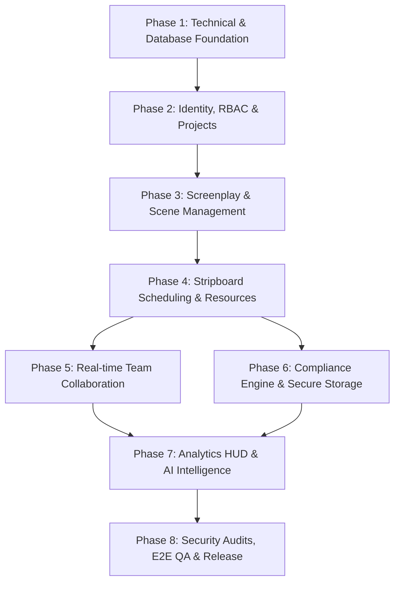

# SceneOS — Implementation Roadmap, Risk Register & Prompt 02 Specification
**Document Version:** 1.0.0  
**Status:** Approved Foundation Blueprint  

---

## 1. Phased Development Roadmap

SceneOS follows a sequential, dependency-aware milestone roadmap. Each phase delivers a testable, vertically integrated capability without premature abstractions.

---

### Detailed Phase Specifications

#### Phase 1 — Technical & Database Foundation (Immediate Focus)
* **Objective:** Establish the clean monorepo/SPA scaffold, Supabase client integration, TypeScript environment, and base database migration.
* **Dependencies:** None.
* **Key Deliverables:**
  * Clean, modular Vite + React 19 + TypeScript frontend structure (refactoring the single-file prototype).
  * Supabase project integration script and initial SQL migration (`001_initial_schema.sql`).
  * Type-safe Supabase database definitions (`types/supabase.ts`).
  * Unit test setup (Vitest + React Testing Library) to verify scheduling and compliance math deterministically.
* **Acceptance Criteria:**
  * Application compiles with zero TypeScript errors (`tsc --noEmit`).
  * Database migration runs cleanly on Supabase/PostgreSQL.
  * Base environment variables loaded via `.env.local`.

#### Phase 2 — Identity, Projects & RBAC
* **Objective:** Secure user authentication and project workspace scoping with server-enforced permissions.
* **Dependencies:** Phase 1.
* **Key Deliverables:**
  * Supabase Auth integration (Email/Password + optional Google OAuth).
  * User profile management and session restoration.
  * Project CRUD (Title, logline, target dates, budget limit, daily burn cap).
  * Project membership invites and role assignments (Owner, Producer, Director, 1st AD, HOD, Crew).
  * RLS policies verified: Non-members cannot query or alter private project rows.
* **Acceptance Criteria:**
  * User can register, verify, sign in, and switch between multiple projects.
  * Attempting to query another project's data returns empty results via RLS.

#### Phase 3 — Scripts, Scenes & Breakdown Engine
* **Objective:** Real screenplay ingestion, scene breakdown, and department element tracking.
* **Dependencies:** Phase 2.
* **Key Deliverables:**
  * Screenplay upload and parsing engine (Fountain screenplay format parser + PDF text extraction fallback).
  * Scene list with standard film metadata: Scene number, INT/EXT, Day/Night, Location, Page Eighths count (e.g. 2 3/8 pgs), and synopsis.
  * Breakdown sheet interface: Tagging characters, props, vehicles, wardrobe, stunts, and special effects per scene.
  * Manual editing and verification workflow for AI-suggested breakdown elements.
* **Acceptance Criteria:**
  * Uploading a standard `.fountain` file parses into discrete scenes with accurate page counts and characters.
  * Verified breakdown items link bi-directionally to their originating scene.

#### Phase 4 — Production Scheduling & Stripboard
* **Objective:** Professional 1st AD stripboard scheduling with automated conflict detection.
* **Dependencies:** Phase 3.
* **Key Deliverables:**
  * Interactive stripboard view: Draggable scene strips categorized by day and location.
  * Shooting-day generation with call time, estimated wrap, and daily page count totals.
  * Cast availability tracker: Alerts when an actor is scheduled past their contracted hold dates.
  * Cascading schedule recalculator: Modifying a shooting date shifts subsequent dependencies.
* **Acceptance Criteria:**
  * Dragging a scene between shooting days updates sequence order and recalculates total day runtimes.
  * Moving a day flags any cast or location conflicts immediately.

#### Phase 5 — Collaboration, Activity & Realtime
* **Objective:** Live updates across department heads and centralized communication.
* **Dependencies:** Phase 4.
* **Key Deliverables:**
  * Supabase Realtime subscriptions for shooting day changes and strip reorders.
  * Project activity feed capturing scene approvals, schedule locks, and call sheet releases.
  * Department messaging channels (e.g., Camera, Grip & Electric, Art Dept, Production Office).
  * User presence indicators on the active schedule board.
* **Acceptance Criteria:**
  * Changes made by the 1st AD reflect on the Producer's browser within 200ms via Realtime.
  * Activity log accurately attributes actions to `auth.uid()`.

#### Phase 6 — Secure Production Content & Compliance Engine
* **Objective:** Multi-guild compliance validation and tamper-resistant document distribution.
* **Dependencies:** Phase 4.
* **Key Deliverables:**
  * Configurable compliance profiles: Bollywood (FWICE), Kollywood (FEFSI), Tollywood (TFIEF), Mollywood (FEFKA), Sandalwood (KFWF), SAG-AFTRA, and Independent mode.
  * 11-point deterministic compliance check evaluating turnaround hours, max shift lengths, meal intervals, and safety medics.
  * Private Supabase Storage bucket with RLS policies for call sheets and script sides.
  * Expiring signed URLs for document access.
* **Acceptance Criteria:**
  * Changing call time to create an 8-hour turnaround triggers a critical compliance violation badge citing guild rules.
  * Unauthorized users cannot access stored PDF documents via direct URL.

#### Phase 7 — Analytics HUD & AI Intelligence
* **Objective:** Executive telemetry, financial burn tracking, and AI-assisted production advisory.
* **Dependencies:** Phases 4, 6.
* **Key Deliverables:**
  * Production cockpit: Speedometer gauges, planned vs actual shot scenes, budget depletion curve.
  * SQL reporting views for Power BI / CSV export.
  * Server-side Gemini 2.5 Edge Function for script breakdown suggestions and schedule risk assessment.
  * Strict guardrail: AI breakdown items are flagged `is_ai_suggested: true` and require human approval.
* **Acceptance Criteria:**
  * AI analysis runs through secure server-side Edge Function; zero API keys exposed in client bundle.
  * Financial metrics update reactively based on scheduled days multiplied by daily burn rate.

#### Phase 8 — Quality, Security & Release
* **Objective:** Production hardening, automated E2E tests, and deployment.
* **Dependencies:** All preceding phases.
* **Key Deliverables:**
  * Playwright E2E suite covering Auth -> Script Import -> Stripboard -> Compliance -> Export.
  * Security penetration scan of RLS policies using Supabase CLI test suite.
  * Production build optimization and deployment documentation (Vercel / Netlify / Cloud Run).
* **Acceptance Criteria:**
  * All E2E workflows pass.
  * Zero high-severity vulnerabilities in dependency audit.

---

## 2. Comprehensive Risk Register

| Risk ID | Category | Description | Likelihood | Impact | Mitigation Strategy |
| :--- | :--- | :--- | :---: | :---: | :--- |
| **RSK-01** | **Security** | Accidental client-side exposure of Supabase `service_role` or Gemini API key. | Medium | Critical | Enforce strict lint rules; all privileged mutations and AI calls route through Supabase Edge Functions. Frontend only receives `anon` key. |
| **RSK-02** | **Data Integrity** | Race conditions during stripboard drag-and-drop leading to duplicate strip orders. | Medium | High | Reorder operations run through a single PostgreSQL transactional RPC function (`reorder_strips`) with optimistic locking. |
| **RSK-03** | **Compliance** | User relies on unverified guild interpretations leading to legal disputes. | Low | High | Clear disclaimers; all compliance profiles display verified statutory sources and last-reviewed dates; mark AI findings as advisory. |
| **RSK-04** | **Technical** | PDF screenplay parsing failures due to non-standard studio formats. | High | Medium | Prioritize standard Fountain/FDX text formats; provide interactive manual review and correction UI when PDF layout parsing encounters ambiguity. |
| **RSK-05** | **Cost** | Excessive Gemini AI token consumption on repeated screenplay re-analyses. | Medium | Low | Hash screenplay text (MD5/SHA256) and cache breakdown outputs in PostgreSQL. AI analysis only runs on manual user trigger. |
| **RSK-06** | **Performance** | Massive monolithic bundle causing slow mobile browser loads on film sets. | Medium | Medium | Code-split routes via `React.lazy`; optimize Lucide icon imports; purge unused Tailwind classes in production build. |

---

## 3. External Setup & Pre-requisite Checklist

Before executing full live deployments, the following external credentials and configurations will be required from the project owner:

1. **Supabase Project:**
   - Supabase project created on [supabase.com](https://supabase.com) (free tier is fully sufficient for MVP).
   - `VITE_SUPABASE_URL`: Project URL (e.g. `https://xyzcompany.supabase.co`).
   - `VITE_SUPABASE_ANON_KEY`: Public anonymous client key.
   - `SUPABASE_SERVICE_ROLE_KEY`: Private key (used **strictly** in Edge Functions or backend CI/CD migrations).
2. **Authentication Configuration (in Supabase Dashboard):**
   - Enable Email/Password authentication.
   - (Optional) Configure Google OAuth client ID and secret in Supabase Auth settings.
3. **Storage Buckets (Created via Migration or Dashboard):**
   - Bucket `scripts`: Private (restricted by RLS).
   - Bucket `production-docs`: Private (restricted by RLS).
   - Bucket `avatars`: Public read, authenticated upload.
4. **AI Studio / Google Gemini:**
   - `GEMINI_API_KEY`: For script breakdown and scheduling intelligence (stored in Supabase Vault / Edge Function secrets).
5. **Git Version Control:**
   - Git needs to be accessible in the development terminal if version control commands are to be executed.

---

## 4. Prompt 02 Exact Next-Step Specification

The foundation and architectural blueprints are now established. The exact scope for **Prompt 02** is defined below:

### Prompt 02: Phase 1 Technical Foundation & Supabase Integration Scaffold
* **Task 1: Clean Project Scaffolding & Directory Restructure**
  - Establish a clean, maintainable modular structure separating `api/`, `components/`, `features/`, `hooks/`, `lib/`, `types/`, and `utils/`.
  - Retain valuable compliance formulas and mock data from the PLÁN prototype into modular domain folders.
* **Task 2: Supabase Client & Environment Configuration**
  - Configure `@supabase/supabase-js` client with typed database schema bindings.
  - Set up safe fallback/mock mode for development when live credentials are not yet configured.
* **Task 3: Initial Database Migration & RLS Scripts**
  - Create the complete SQL migration file (`supabase/migrations/001_initial_schema.sql`) implementing the core tables (`profiles`, `projects`, `project_members`, `scripts`, `scenes`, `breakdown_items`, `schedules`, `shooting_days`, `compliance_profiles`, `audit_logs`) and security-definer helper functions.
* **Task 4: Quality & Validation Pipeline**
  - Configure TypeScript strict mode, ESLint, and initial test suite for the scheduling cascading engine and compliance rule evaluator.
  - Verify zero build or compilation errors.
