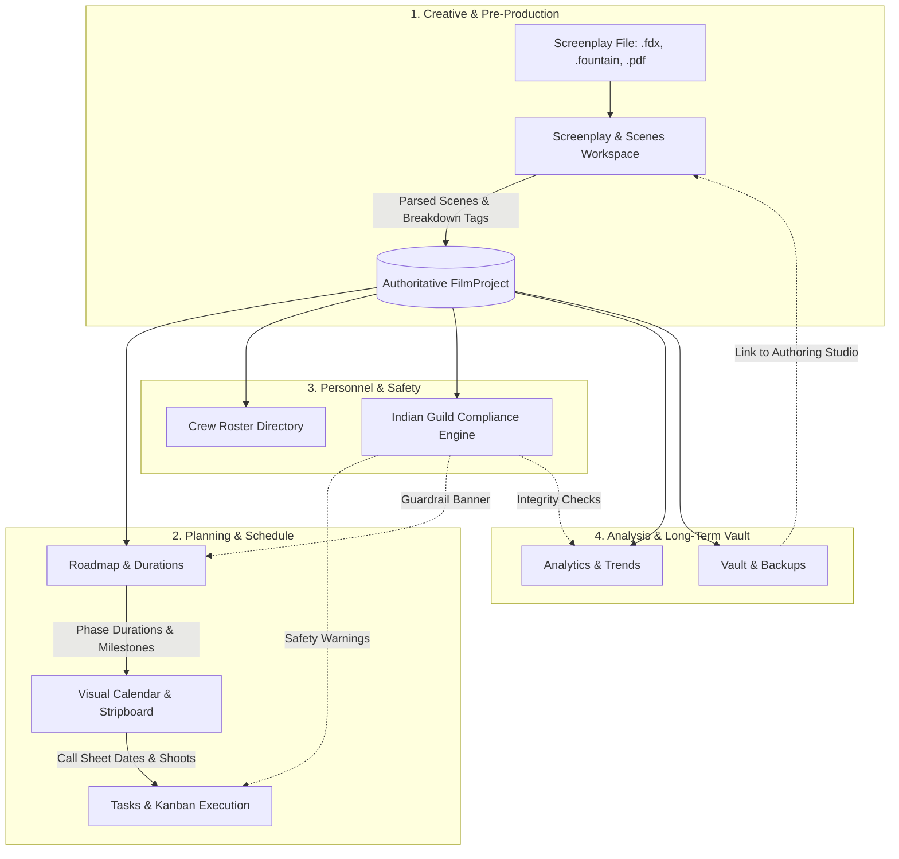

# SceneOS — Phase 3A.3: Workspace Boundaries, Information Architecture & End-to-End Production Workflow

**Status:** Completed & Verified  
**Date:** October 15, 2026  
**Scope:** Architecture Refactoring, Cross-Module De-duplication, Entity Ownership Formalization, and End-to-End Lifecycle Navigation

---

## 1. Executive Summary

Phase 3A.3 resolves the structural information-architecture challenges identified across the SceneOS application. Prior to this milestone, several workspaces contained duplicated calculation engines, dead legacy code branches, cross-module content leakage, and out-of-order navigation tabs.

This engineering milestone strictly establishes:
1. **The Definitive Film-Production Lifecycle Order:**
   $$\text{Screenplay} \longrightarrow \text{Breakdown} \longrightarrow \text{Roadmap} \longrightarrow \text{Calendar} \longrightarrow \text{Tasks} \longrightarrow \text{Crew} \longrightarrow \text{Compliance} \longrightarrow \text{Analytics} \longrightarrow \text{Vault}$$
2. **Authoritative Entity Ownership:** Every workspace has exclusive write-ownership over its domain models. Secondary modules consume read-only summaries and direct users to the authoritative studio via seamless cross-module links.
3. **Single-Source Compliance Calculation:** Purged 290+ lines of duplicated ad-hoc safety calculation loops across `ProjectProgressionGraph` and `FilmKanbanBoard`, standardizing all checks through the pure `evaluateProjectCompliance(project)` engine.
4. **Specialized Production Analytics Workspace:** Elevated the inline dashboard metric grid into an authoritative `ProductionAnalyticsWorkspace` displaying planned vs simulated vs actual velocity, completion bond reserves, phase duration distributions, and priority spread.
5. **Cold-Storage Archival Separation:** Transformed the Screenplay tab in `FilmAssetsModule` from an ad-hoc screenplay editor into an immutable archival audit snapshot that links cleanly to the **Screenplay & Scenes Studio**.

---

## 2. Workspace Responsibility Matrix

| # | Workspace ID | Display Label | Primary Purpose & Authoritative Scope | Anti-Scope (What it does NOT own) |
|---|-------------|---------------|---------------------------------------|-----------------------------------|
| **0** | `console` | **Overview** | Executive 3-second orientation, headline KPIs, countdown instrument, speedometer dials, active phase checkpoints, and operational entry points. | Does NOT perform detailed line item edits, screenplay parsing, or direct raw data mutations. |
| **1** | `screenplay` | **Screenplay & Scenes** | Ingestion of screenplay formats (.FDX, .FOUNTAIN, .PDF, .DOCX, .TXT), slugline ordering, automated Hollywood eighths breakdown, character extraction, and breakdown tagging (`props`, `wardrobe`, `vehicle`, `stunt`, `vfx`). | Does NOT manage calendar call sheets or camera card hash checksums. |
| **2** | `phases` | **Roadmap & Durations** | Production roadmap, phase durations (Pre, Prod, Post), milestone dependency sequencing, duration recalculation, and critical path tracking. | Does NOT replicate guild compliance rule calculators or dead swimlanes. |
| **3** | `calendar` | **Visual Calendar** | Day-by-day shooting calendar, stripboard sequencing, call sheet scheduling, rest turnaround intervals, and location schedules. | Does NOT manage script dialogue revisions or talent contract legalities. |
| **4** | `master-calendar` | **Tasks & Kanban** | Operational task execution checklist, sub-tasks, assignees, priorities, blockers, and card progress. | Does NOT calculate custom labor violation penalties; pulls warnings directly from the compliance engine. |
| **5** | `crew` | **Crew Roster** | Master personnel rolodex, operational departments (Direction, Camera, Lighting, Sound, Art), contact info, and availability. | Strictly separates operational filmmaking job titles from SceneOS platform RBAC security roles (`Admin`, `Editor`, `Viewer`). |
| **6** | `constraints` | **Guild Compliance** | Sole authoritative owner of safety and labor rules across Indian Guilds (FWICE, FEFSI, TFIEF, FEFKA, KFWF, Independent), turnaround hours, meal break caps, overtime multipliers, and audit logs. | Does NOT store task checklists or scene breakdown tags. |
| **7** | `telemetry` | **Analytics & Trends** | Historical performance velocity, planned vs simulated vs actual progress, 10% Completion Bond reserve calculations, phase duration ratios, and financial burn trends. | Does NOT replicate project configuration inputs; provides analytical intelligence. |
| **8** | `assets` | **Vault & Backups** | Cold-storage footage card logs, camera checksum verifications (MD5), immutable screenplay freeze snapshots, and project blueprint backups. | Does NOT serve as an interactive screenplay editor or live script drafting studio. |

---

## 3. Duplication & Cross-Module Leakage Audit

### Audit Findings & Corrective Action Taken

| Location | Prior State (Problem) | Root Cause | Solution Implemented |
|----------|-----------------------|------------|----------------------|
| `src/components/ProjectProgressionGraph.tsx` | Contained 660+ lines of dead swimlanes code (`{false && ...}`) and a duplicated 250-line local 11-rule compliance audit loop. | Feature creep and copy-pasted rules before the centralized compliance engine was built. | Purged all dead swimlanes code; replaced the local duplicate loop with a labor & safety guardrail banner that links directly to `Guild Compliance`. |
| `src/components/FilmKanbanBoard.tsx` | Contained 40 lines of duplicated constraint calculations (`isTurnaroundSafe`, `isWorkdaySafe`, `isMealSafe`, `isBondSafe`). | Cards evaluated ad-hoc safety checks locally rather than referencing the compliance service. | Replaced local calculations with `evaluateProjectCompliance(project)` and mapped task safety warnings directly from `compliance.checks`. |
| `src/components/FilmAssetsModule.tsx` | Hosted an ad-hoc screenplay commit form and file upload box inside the Vault, creating a competing script-ingestion path. | Assets module was originally designed as a catch-all storage bucket before dedicated screenplay ingestion existed. | Replaced upload form with a read-only authoritative script archive card displaying version, scene count, eighths, and an `Open Screenplay & Scenes Studio →` action. |
| `src/App.tsx` (Telemetry Tab) | Rendered a simple 3-card inline grid with placeholder metrics and duplicate phase bars. | Temporary placeholder UI left in main application layout. | Extracted into [`ProductionAnalyticsWorkspace.tsx`](file:///C:/Users/Suhaib/Downloads/pl-an-project-main/pl-an-project-main/src/features/analytics/ProductionAnalyticsWorkspace.tsx) with genuine analytical instruments. |
| `src/App.tsx` (Navigation Bar) | Navigation tab order placed constraints and crew before calendar and tasks (`['console', 'screenplay', 'phases', 'constraints', 'crew', 'calendar', 'master-calendar', 'telemetry', 'assets']`). | Arbitrary tab positioning that failed to mirror the film production process. | Reordered to natural lifecycle: `Overview` → `Screenplay` → `Roadmap` → `Calendar` → `Tasks` → `Crew` → `Compliance` → `Analytics` → `Vault`. |

---

## 4. Entity Ownership & Data-Flow Architecture

---

## 5. Verification & Test Suite Summary

### Test Results
- **Total Test Files:** 10 passing (100%)
- **Total Unit & Integration Tests:** 76 passing (0 failures)
- **TypeScript Static Verification:** `npx tsc --noEmit` exited with code 0 (zero type errors)
- **Production Build:** `npm run build` completed cleanly in 10.16s
- **Dev Server Probing:** `http://localhost:3000/` responded with HTTP 200 OK

### Key Test Assertions Verified in `tests/workspace_boundaries.test.ts`:
1. **Lifecycle Order:** Asserts exact 9-workspace sequence matching production workflows.
2. **Pure Single-Source Compliance:** Evaluates 11-point safety rules via `evaluateProjectCompliance(project, 'FWICE')`.
3. **Analytics Math:** Verifies completion bond calculations (`budgetLimit * 0.10`), task completion percentages, duration distributions, and priority spread.
4. **Boundary Isolation:** Confirms screenplay versioning breakdown metadata remains isolated to Screenplay Studio while Vault acts strictly as an immutable snapshot archive.
5. **Operational Rolodex Isolation:** Asserts crew operational filmmaking titles never collide with or grant system RBAC privileges.
