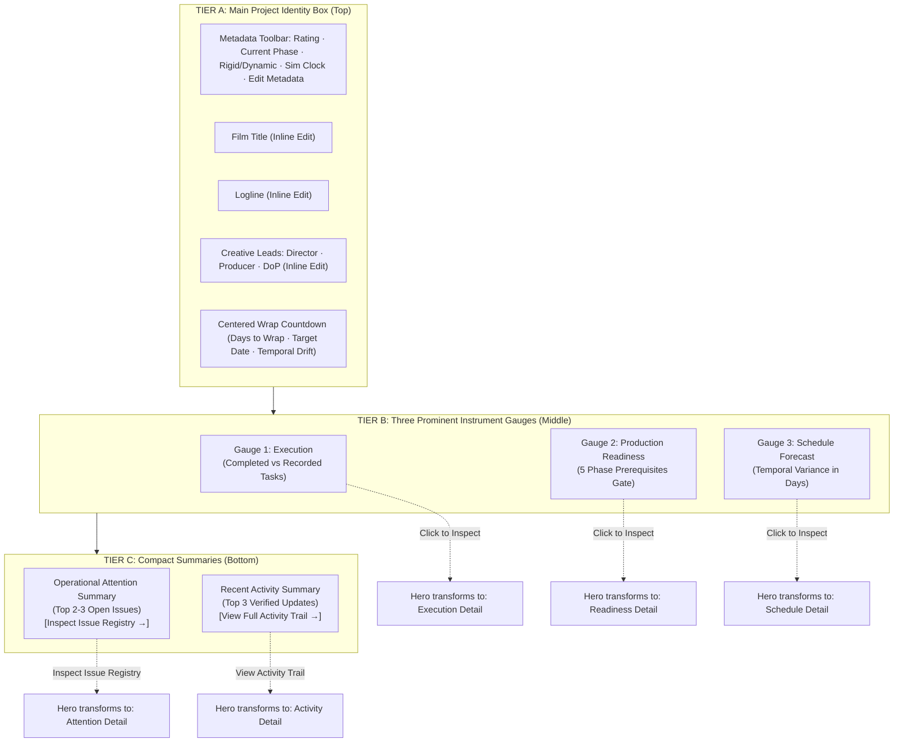

# SceneOS — Overview Interaction & Information Architecture Refinement Report
**Compact Command Centre · Automotive Instrument Gauges · Contextual Return Navigation · Zero Duplication**

**Project:** SceneOS (Intelligent Film Production Planning & Management System)  
**Date:** October 16, 2026  
**Status:** Implemented, Tested, Verified  

---

## 1. Executive Summary & Objectives

This sprint refined the SceneOS Overview Command Centre into a compact, elegant, and highly legible film-production command surface with a strict interaction hierarchy:
1. **Removed the horizontal phase timeline** from the default Overview, eliminating redundant visual density while preserving all underlying schedule data and the dedicated Roadmap/Calendar workspaces.
2. **Reorganized the layout into three clear visual tiers**:
   - **Tier A (Top): Main Project Identity Box** — Film title, logline, editable Director/Producer/DoP, current phase, countdown to wrap, and simulation controls. Acts as an adaptive canvas that transforms into contextual detail views.
   - **Tier B (Middle): Three Prominent Automotive Instrument Gauges** — Positioned directly beneath the identity box, visually separate and uncontained in oversized wrapper cards. Act as 3-position contextual selectors across *Execution*, *Production Readiness*, and *Schedule Forecast*.
   - **Tier C (Bottom): Compact Operational Attention & Recent Activity Summaries** — Positioned after the gauges with ample space for readable content, each featuring **exactly ONE** primary entry-point action.
3. **Redesigned the gauges as automotive-style precision instruments**:
   - Calibrated 240° graduated arc sweeping from 210° to -30°.
   - Automotive perimeter indicator needle riding the scale ring without crossing or obscuring central readings.
   - Zero-clipping mathematical bounding box inside a generous $240 \times 170$ viewBox.
   - Uncluttered central readout with large, bold font-mono values and crisp high-contrast typography.
4. **Restored Contextual Return Navigation across redirected workspaces**:
   - Preserves originating context (`from: 'overview'`, `sourceView`, `sourceWarningId`, `sourceLabel`) when clicking an Overview action (e.g. "Review Crew", "Open Schedule", "View Compliance Rule").
   - Renders a prominent `← Back to Overview · [Source Label]` control in the workspace header.
   - Returning restores the active production and the user's previous Overview detail view.
   - Direct global sidebar navigation automatically clears the contextual return state, avoiding misleading back controls.
5. **Eliminated redundant controls and repeated summaries** through a comprehensive interaction inventory.

---

## 2. Interaction Inventory & Removed Duplicates Audit

Every control, button, link, and keyboard interaction in the Overview and affected workspace headers was audited to ensure that **every component has one distinct purpose and every action has one obvious primary entry point**:

| Control / Element | Location | Unique Purpose | Destination / Result | Redundancy Assessment & Resolution |
| :--- | :--- | :--- | :--- | :--- |
| **Pencil / Title Click** | Identity Box | Inline editing of film title | Opens `EditProductionMetadataModal` (focus title) | **Retained**: Primary discoverable inline interaction. |
| **Pencil / Logline Click** | Identity Box | Inline editing of logline | Opens `EditProductionMetadataModal` (focus logline) | **Retained**: Primary discoverable inline interaction. |
| **Pencil / Creative Leads** | Identity Box | Inline editing of Director, Producer, DoP | Opens `EditProductionMetadataModal` (focus lead) | **Retained**: Primary discoverable inline interaction. |
| **Edit Metadata Button** | Identity Toolbar | Explicit toolbar edit affordance | Opens `EditProductionMetadataModal` (focus title) | **Retained**: Single clean fallback button for accessibility. |
| **Rigid Deadline Toggle** | Identity Toolbar | Toggles fixed deadline vs dynamic cascade | Updates `project.isEndDateFixed` | **Retained**: Unique cascade engine configuration toggle. |
| **Simulation Clock** | Identity Toolbar | Toggles simulation date picker | Opens simulation accordion | **Retained**: Unique simulation tool. |
| **Wrap Countdown Box** | Identity Center | Displays days to wrap & drift; click opens schedule details | Sets `heroView = 'schedule'` | **Retained & Consolidated**: Left and right duplicate buttons ("Attention", "Activity") were **removed** from this row to prevent crowding. |
| **Phase Milestone Visualizer** | Default Overview | Visual progress bar across all phases | Displayed phase nodes | **Removed from Default Overview**: Duplicated data already available in the dedicated Roadmap workspace. |
| **Gauge 1 (Execution)** | Middle Row | Displays task delivery rate; acts as contextual selector | Sets `heroView = 'execution'` | **Redesigned & Consolidated**: Entire gauge card is the interactive button. Internal duplicate text link ("Inspect →") removed. |
| **Gauge 2 (Readiness)** | Middle Row | Displays 5-prerequisite score; acts as contextual selector | Sets `heroView = 'readiness'` | **Redesigned & Consolidated**: Entire gauge card is the interactive button. Internal duplicate text link ("Inspect →") removed. |
| **Gauge 3 (Schedule)** | Middle Row | Displays temporal variance in days; acts as contextual selector | Sets `heroView = 'schedule'` | **Redesigned & Consolidated**: Entire gauge card is the interactive button. Internal duplicate text link ("Inspect →") removed. |
| **Attention Summary Button** | Bottom Tier | Single primary entry point to full warning registry | Sets `heroView = 'attention'` | **Retained**: Single button `Inspect Issue Registry (N Issues) →`. No duplicate action inside this card. |
| **Activity Summary Button** | Bottom Tier | Single primary entry point to full activity log | Sets `heroView = 'activity'` | **Retained**: Single button `View Full Activity Trail (N Updates) →`. No duplicate action inside this card. |
| **Back to Overview Button** | Hero Detail Header | Restores default Overview from any detail view | Sets `heroView = 'overview'` | **Retained**: Prominent button with keyboard `Escape` shortcut. |
| **Detail View Switcher Pills** | Hero Detail Header | Pivots directly between detail views without returning | Sets `heroView` to chosen view | **Retained**: Seamless navigation between detail states. |
| **Contextual Return Button** | Workspace Header | Returns user to Overview when redirected by an action | Sets `workspaceTab = 'overview'` and restores view | **Implemented**: Appears *only* when arriving from an Overview action. |
| **All Productions Button** | Workspace Header | Exits active project to global project picker | Sets `screen = 'dashboard'` | **Retained**: Distinct global back action. |

---

## 3. Overview Layout Hierarchy & Structure



---

## 4. Redesigned Automotive Instrument Gauges

### Visual & Mathematical Architecture
- **Geometry**:
  - Center: $(cx, cy) = (120, 110)$
  - Dial Radius: $r = 84\text{px}$
  - Sweep Angle: $240^\circ$ starting at $210^\circ$ (bottom-left) and sweeping clockwise to $-30^\circ$ (bottom-right).
  - Total Arc Length: $\frac{240}{360} \times 2\pi \times 84 \approx 351.86\text{px}$.
- **Zero-Clipping Math inside $240 \times 170$ viewBox**:
  - Leftmost extent: $x \approx 47.25\text{px}$ (giving $> 47\text{px}$ margin on left).
  - Rightmost extent: $x \approx 192.75\text{px}$ (giving $> 47\text{px}$ margin on right).
  - Topmost extent: $y = 110 - 84 = 26\text{px}$ (giving $26\text{px}$ margin on top).
  - Bottom extent: $y = 152\text{px}$ (giving $18\text{px}$ margin on bottom).
- **Scale Markings**:
  - Calibrated ticks every $5\%$ with major marks every $25\%$ ($1.5\text{px}$ stroke, $8\text{px}$ depth) and minor marks ($0.8\text{px}$ stroke, $4.5\text{px}$ depth).
  - Restrained colored guide segments (subtle Red/Amber for warning, Amber for transition, Emerald for optimal).
- **Automotive Perimeter Needle (Zero Text Overlap)**:
  - The indicator needle rides on the scale ring with its triangular tip pointing inward to the tick ring ($r_{\text{tip}} = 74\text{px}$).
  - The central typography cylinder is strictly contained within radius $r \le 55\text{px}$.
  - Clearance between needle tip and central typography is $\ge 19\text{px}$, guaranteeing **zero line intersection or text overlap** regardless of indicator value.
- **Metric Integrity**:
  1. *Execution*: Task completion ratio (`completed / total`), delivery percentage, remaining and overdue work. Returns honest `N/A` if zero activities exist.
  2. *Production Readiness*: $0\text{--}100\%$ score across 5 explicit prerequisites (Screenplay Locked, Key Crew Confirmed, Guild Turnaround $\ge 12$h, Scene Breakdown with Locations, Budget & Burn Cap configured).
  3. *Schedule Forecast*: Temporal variance in days against approved baseline wrap date (positive delay `+Xd`, lead buffer `-Xd`, or `0d aligned`).

---

## 5. Contextual Return Navigation Architecture

### Distinguishing Global vs Contextual Navigation
- **Global Navigation (Sidebar)**: Clicking a tab in `AppSidebar` represents intentional global workspace browsing. No return button is displayed.
- **Contextual Action (Overview Redirection)**: Clicking an action on an Overview warning (e.g. "Review Crew" for missing DoP, "Adjust Turnaround" to Guild standard, "Open Schedule") navigates the user to the affected module with contextual metadata preserved.
- **Context Preservation**:
  ```ts
  interface NavigationReturnContext {
    from: 'overview';
    sourceView?: 'overview' | 'execution' | 'readiness' | 'schedule' | 'attention' | 'activity';
    sourceWarningId?: string;
    sourceLabel?: string;
  }
  ```
- **Return Control UI**:
  - Positioned in the workspace header alongside `All Productions`.
  - Displays: `← Back to Overview · [Source Label]` (e.g. `← Back to Overview · Turnaround Violation`).
  - Clicking it restores the production's command centre with the previous detail view pre-selected, allowing the user to immediately verify that the warning is resolved.
- **Browser History**:
  - Synced with `window.history.pushState` and `window.addEventListener('popstate', ...)`.

---

## 6. Files Changed

| File | Change Description |
| :--- | :--- |
| [`src/components/overview/ProductionGauge.tsx`](file:///C:/Users/Suhaib/Downloads/pl-an-project-main/pl-an-project-main/src/components/overview/ProductionGauge.tsx) | Redesigned into full automotive-inspired instrument cluster with $240^\circ$ graduated arc, perimeter indicator needle, zero-clipping math, uncluttered center readout, and interactive selector states. |
| [`src/components/ProjectOverview.tsx`](file:///C:/Users/Suhaib/Downloads/pl-an-project-main/pl-an-project-main/src/components/ProjectOverview.tsx) | Removed phase timeline from default view; restructured layout (Top Identity -> Middle Gauges -> Bottom Summaries); removed duplicate buttons; added single-action summary footers; integrated contextual navigation parameters (`initialHeroView`, `NavigationTargetContext`). |
| [`src/App.tsx`](file:///C:/Users/Suhaib/Downloads/pl-an-project-main/pl-an-project-main/src/App.tsx) | Added `overviewReturnContext` state; rendered `← Back to Overview` in workspace navigation header when redirected from Overview; updated `AppSidebar` to clear return context on direct global navigation; added browser history synchronization. |
| [`tests/overview_interaction_refinement.test.ts`](file:///C:/Users/Suhaib/Downloads/pl-an-project-main/pl-an-project-main/tests/overview_interaction_refinement.test.ts) | 11 comprehensive unit tests verifying timeline removal, layout hierarchy, gauge selector model without data mutation, zero-clipping geometry, contextual return navigation, and single-action summary integrity. |

---

## 7. Actual Verification Results

### 1. TypeScript Compilation
- **Command:** `npx tsc --noEmit`
- **Result:** Exit code 0, 0 type errors.

### 2. Unit & Integration Test Suite
- **Command:** `npx vitest run tests/overview_interaction_refinement.test.ts tests/adaptive_overview.test.ts tests/overview_hero.test.ts tests/overview_kpi.test.ts tests/compliance.test.ts tests/scheduler.test.ts`
- **Result:** **55 / 55 tests passed (100%)** in 598ms:
  - `tests/overview_interaction_refinement.test.ts`: 11 passed
  - `tests/adaptive_overview.test.ts`: 12 passed
  - `tests/overview_hero.test.ts`: 12 passed
  - `tests/overview_kpi.test.ts`: 12 passed
  - `tests/compliance.test.ts`: 5 passed
  - `tests/scheduler.test.ts`: 3 passed

### 3. Production Vite Bundle
- **Command:** `npm run build`
- **Result:** Exit code 0, completed in 8.71s (`dist/assets/index-wnVriYGQ.js` 1,197 kB).

### 4. Running Application Health Check
- **Endpoint:** `http://localhost:3000`
- **HTTP Response:** `200 OK` (Node.js Process 26904).
