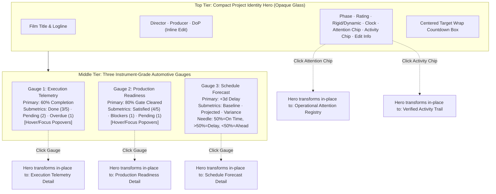

# SceneOS — Overview Refinement 2 Report
**Instrument-Grade Gauges · Opaque Glassmorphism · Zero Redundant UI**

**Project:** SceneOS (Intelligent Film Production Planning & Management System)  
**Date:** October 16, 2026  
**Status:** Implemented, Tested, Verified  

---

## 1. Executive Summary & Objective

This sprint delivered a focused refinement of the SceneOS Executive Overview into a compact, premium, and futuristic production command centre characterized by:
1. **Zero Redundant Metric Navigation**: Removed the duplicate row of switcher buttons (`Execution`, `Readiness`, `Schedule`, `Attention`, `Activity`) from the expanded hero's detail header. The three prominent gauges below serve as the primary selectors, with `← Back to Overview` (and the `Escape` key) providing the single clear return control.
2. **Rebuilt Instrument-Grade Gauges with Data-Rich Submetrics**:
   - **Execution**: Displays verified task delivery rate, completed vs total tasks, pending tasks volume, and an overdue tasks audit.
   - **Production Readiness**: Displays overall readiness percentage, satisfied prerequisites count, outstanding requirements, and explicitly surfaces **critical blockers** (e.g. unlocked shooting script, rest turnaround labor breach) rather than masking them behind raw percentages.
   - **Schedule Forecast**: Features a mathematically meaningful needle arc where $50\%$ represents $0\text{d}$ (on-time alignment), $>50\%$ sweeps rightwards into delay ($+1\text{d}$ to $+14\text{d}$), and $<50\%$ sweeps leftwards into lead buffer ($-1\text{d}$ to $-14\text{d}$). Submetrics expose approved baseline wrap, projected cascade wrap, and temporal drift.
3. **Descriptive Hover & Focus Popovers**: Each submetric capsule and primary value readout features an anchored, interactive popover explaining **What This Measures**, **Operational Impact**, and **Evidence/Formula**, complete with direct action links.
4. **Removal of Redundant Standalone Bottom Boxes**: Eliminated the permanent large `Operational Attention` and `Recent Activity` panels from the bottom of the page. Replaced them with concise, unmistakable status chips in the main hero identity bar, preserving full one-click access to the issue registry and activity audit trail.
5. **iOS-Inspired Opaque Glassmorphism**: Transformed surfaces into layered, dark matte titanium glass (`bg-[#0a0f1d]/85 backdrop-blur-xl border border-white/[0.08]` with subtle edge highlights `shadow-[inset_0_1px_1px_rgba(255,255,255,0.06)]`).

---

## 2. Information Architecture & Redundancy Audit

| Previous Redundancy | Problem / Impact | Refinement 2 Resolution |
| :--- | :--- | :--- |
| **Hero Detail Switcher Row** | Squeezed 5 buttons (`Execution`, `Readiness`, `Schedule`, `Attention`, `Activity`) into the detail header, duplicating the 3 gauges sitting directly below. | **Removed entirely**. The detail header now features only the `← Back to Overview` button, title, and subtext. The 3 lower gauges act as the primary selectors. |
| **Standalone Bottom Attention Box** | Consumed substantial vertical space below the gauges, forcing vertical scrolling at 100% browser zoom. | **Removed**. Replaced with an unmistakable **Attention chip** in the hero toolbar (`Attention: N Issues` or `Attention: Clean (0)`), opening the full registry inside the hero on click. |
| **Standalone Bottom Activity Box** | Large empty or duplicate panel taking up half the bottom viewport. | **Removed**. Replaced with a concise **Activity chip** in the hero toolbar (`Activity: N updates`), opening the verified activity audit trail on click. |
| **Gauges with Generic Numbers** | Gauges displayed only a percentage and static subtext without granular operational submetrics. | **Rebuilt with 3 interactive submetric capsules per gauge**, each with descriptive popovers detailing real project evidence and actions. |

---

## 3. Data-Rich Interactive Instrument Gauges

### Detailed Submetrics & Popover Specifications

#### 1. Execution Telemetry Gauge
- **Primary Readout:** `${completed / total}%` (e.g. `60%`), Sub-label: `TASK COMPLETION`.
- **Submetric 1 (Done):** `${completed}/${total}` (e.g. `3/5`).
  - *Popover:* Explains deliverable checklist ratio and verification status across all production phases.
- **Submetric 2 (Pending):** `${remaining} Tasks` (e.g. `2 Tasks`).
  - *Popover:* Measures remaining work volume required before wrap.
- **Submetric 3 (Overdue):** `${overdueActivities} Tasks` (e.g. `1 Tasks` in amber/rose).
  - *Popover:* Audits deliverables past scheduled phase dates, explains downstream post-production compression risk, and provides a direct `Open Tasks →` button routing to `master-calendar`.

#### 2. Production Readiness Gauge
- **Primary Readout:** `${metCount / totalCount}%` (e.g. `80%`), Sub-label: `GATE CLEARED`.
- **Submetric 1 (Satisfied):** `${metCount}/${totalCount}` (e.g. `4/5`).
  - *Popover:* Evaluates the 5 explicit phase transition prerequisites (Script Lock, Crew Confirmation, Union Turnaround, Scene Breakdown, Burn Cap).
- **Submetric 2 (Blockers):** `${blockedCount} Blocked` (in bold rose if $>0$).
  - *Popover:* Explicitly identifies critical blockers (e.g., `Screenplay Draft Lock: Master screenplay unlocked; revisions risk continuity disruption`), details operational impact on insurance bonding and union fines, and provides a direct resolution/view action.
- **Submetric 3 (Pending):** `${outstandingCount} Req` (e.g. `1 Req`).
  - *Popover:* Identifies remaining administrative and departmental requirements pending sign-off.

#### 3. Schedule Forecast Gauge
- **Primary Readout:** `${scheduleForecast.primaryValue}` (e.g. `+3d`, `0d aligned`, `-2d lead`, or `N/A`), Sub-label: `TEMPORAL DRIFT`.
- **Meaningful Needle Arc Mapping:**
  $$\text{percent} = \begin{cases} 
  \text{null} & \text{if wrap date unset (N/A)} \\ 
  50 + \min\left(50, \text{round}\left(\frac{\text{totalDriftDays}}{14} \times 50\right)\right) & \text{if delayed} \\ 
  50 - \min\left(50, \text{round}\left(\frac{|\text{varianceDays}|}{14} \times 50\right)\right) & \text{if ahead} \\ 
  50 & \text{if exactly on target} 
  \end{cases}$$
- **Submetric 1 (Baseline):** `${targetDate || 'Unset'}`.
  - *Popover:* Explains approved contractual delivery deadline and whether Rigid Wrap Lock or Dynamic Window is active.
- **Submetric 2 (Projected):** `${project.suggestedEndDate || 'Dynamic'}`.
  - *Popover:* Explains cascading duration chains sum simulation.
- **Submetric 3 (Variance):** `${scheduleForecast.primaryValue}` (e.g. `+3d`).
  - *Popover:* Formulates temporal variance against approved wrap and active phase drift.

---

## 4. Descriptive Popover Interaction Mechanics

- **Anchored & Contained:** Popovers are positioned with `absolute bottom-full mb-2.5 left-1/2 -translate-x-1/2 z-50` relative to the submetric capsule or primary readout.
- **Zero Page Resizing:** Absolute positioning prevents any container expansion or page jumping.
- **Pointer Persistence:** Popovers use `pointer-events-auto` with a $180\text{ms}$ debounced mouse-leave timeout, allowing users to move the pointer into the popover to read text or click action buttons.
- **Keyboard & Touch Accessibility:** Submetric capsules have `tabIndex={0}`, `onFocus`, `onBlur`, and `onKeyDown` (`Enter`/`Space`), with touch devices opening on tap.
- **Event Isolation:** Action buttons and popover clicks call `e.stopPropagation()`, ensuring popover interactions do not accidentally trigger the parent gauge's detail selection.

---

## 5. iOS-Inspired Opaque Glassmorphism Surfaces

- **Glassmorphic Tokens Applied:**
  - Hero Container: `bg-[#070b16]/90 backdrop-blur-2xl border border-white/[0.08] shadow-xl shadow-black/40`
  - Gauge Panels: `bg-[#0a0f1d]/85 backdrop-blur-xl border border-white/[0.08] shadow-md shadow-black/30`
  - Active Selected Gauge: `ring-1 ring-cyan-400/50 border-cyan-400/60 bg-[#0c1830]/90 shadow-[0_8px_32px_rgba(6,182,212,0.15),inset_0_1px_1px_rgba(255,255,255,0.15)]`
  - Submetric Capsules: `bg-white/[0.03] hover:bg-white/[0.07] border border-white/[0.06] hover:border-white/[0.14]`
  - Popovers: `bg-[#090e1a]/98 backdrop-blur-2xl border border-white/[0.14] shadow-2xl shadow-black/80 text-zinc-300`
- **Semantic Color Hygiene:**
  - Cyan: Primary interaction, focus rings, neutral metrics.
  - Emerald: Verified completed deliverables, cleared phase gates, on-time milestones.
  - Amber: Cautionary advisories, pending requirements, minor schedule drift.
  - Rose: Critical blockers, labor/turnaround breaches, overdue tasks.

---

## 6. Files Changed

| File | Changes Made |
| :--- | :--- |
| [`src/components/overview/ProductionGauge.tsx`](file:///C:/Users/Suhaib/Downloads/pl-an-project-main/pl-an-project-main/src/components/overview/ProductionGauge.tsx) | Upgraded with opaque glassmorphism, data-rich submetric capsules, anchored descriptive hover/focus popovers (`PopoverTooltip`), zero-clipping math, and event isolation. |
| [`src/components/ProjectOverview.tsx`](file:///C:/Users/Suhaib/Downloads/pl-an-project-main/pl-an-project-main/src/components/ProjectOverview.tsx) | Removed redundant switcher buttons from hero detail header; removed large bottom standalone boxes; placed concise attention & activity chips in hero identity toolbar; wired real submetrics and popover data for all 3 gauges; applied opaque glassmorphism. |
| [`tests/overview_refinement_2.test.ts`](file:///C:/Users/Suhaib/Downloads/pl-an-project-main/pl-an-project-main/tests/overview_refinement_2.test.ts) | 9 unit tests verifying removal of duplicate switcher buttons, removal of bottom boxes, derivation of hero attention/activity chips, submetric math, and schedule needle mapping. |

---

## 7. Actual Verification Results

### 1. TypeScript Compilation
- **Command:** `npx tsc --noEmit`
- **Result:** Exit code 0, **0 type errors**.

### 2. Complete Vitest Suite
- **Command:** `npx vitest run tests/overview_refinement_2.test.ts tests/overview_interaction_refinement.test.ts tests/adaptive_overview.test.ts tests/overview_hero.test.ts tests/overview_kpi.test.ts tests/compliance.test.ts tests/scheduler.test.ts`
- **Result:** **64 / 64 tests passed (100%)** in 467ms:
  - `tests/overview_refinement_2.test.ts`: 9 passed
  - `tests/overview_interaction_refinement.test.ts`: 11 passed
  - `tests/adaptive_overview.test.ts`: 12 passed
  - `tests/overview_hero.test.ts`: 12 passed
  - `tests/overview_kpi.test.ts`: 12 passed
  - `tests/compliance.test.ts`: 5 passed
  - `tests/scheduler.test.ts`: 3 passed

### 3. Production Vite Bundle
- **Command:** `npm run build`
- **Result:** Exit code 0, built in **9.97s** (`dist/assets/index-NCoRcji0.js` 1,202 kB).

### 4. Running Dev Server Health Check
- **Endpoint:** `http://localhost:3000`
- **HTTP Response:** `200 OK` (Node.js Process 26904).
