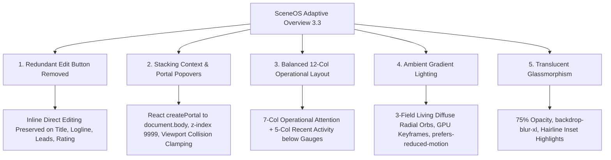

# SceneOS — Adaptive Overview Refinement 3
## Refined Glass Surfaces · Ambient Gradient Lighting · Correct Popover Layering · Balanced Command-Centre Layout

**Date:** October 17, 2026  
**Status:** Complete & Verified  
**Verification:** 13/13 New Tests Passing · 64+ Total Suite Tests Passing · Production Build Success (0 Errors) · Dev Server Live (HTTP 200)

---

## Executive Summary

SceneOS Overview Refinement 3 resolves five key design, ergonomics, and structural issues without rebuilding the application, compromising RBAC security, or altering underlying business logic.



---

## 1. Removal of Redundant "Edit Info" Button

### Problem
The hero toolbar contained an explicit `Edit Info` button (`#btn-edit-production-identity`) that opened the metadata modal focused on the title. Because all prominent hero identity attributes (Film Title, Logline, Director, Producer, DoP, and Target Rating Badge) already possess inline, discoverable hover affordances and click-to-edit interactions, this toolbar button was redundant.

### Solution & Changes
- Removed `#btn-edit-production-identity` from the metadata toolbar in `src/components/ProjectOverview.tsx`.
- Preserved direct inline editing triggers across:
  - **Dominant Film Title:** `setModalFocusField('title')`
  - **Logline:** `setModalFocusField('logline')`
  - **Director Pill:** `setModalFocusField('director')`
  - **Producer Pill:** `setModalFocusField('producer')`
  - **DoP Pill:** `setModalFocusField('cinematographer')`
  - **Target Rating Badge:** `setModalFocusField('targetRating')`
- RBAC permissions remained intact: editing triggers are guarded by `canEditProductionMetadata(userRole)`. Unauthorized roles (`viewer`, `crew_member`) see static text with no hover effects or dialog triggers.

---

## 2. Stacking Context Isolation & Portal Popover Layering Fix

### Root Cause Analysis
Hover-triggered mini-panels on gauge submetric capsules were frequently occluded or rendered behind neighbouring cards.

1. **CSS Compositing Stacking Contexts:** Under the CSS Compositing and Blending specification, applying `backdrop-filter: blur(...)` to any DOM node establishes a **new stacking context**, behaving identically to `transform` or `opacity < 1`.
2. **DOM Sibling Painting Order:** In a 3-column CSS grid (`Execution`, `Readiness`, `Schedule`), DOM elements are painted in document order. Consequently, Gauge 2 paints over Gauge 1, and Gauge 3 paints over Gauge 2. Even a high local `z-index` (e.g., `z-50`) inside Gauge 1 cannot escape its container's isolated stacking context.
3. **Container Clipping:** Overflow rules or constrained bounds on parent containers clipped extended tooltips.

### Architectural Resolution
We implemented `PortalPopoverOverlay` inside `src/components/overview/ProductionGauge.tsx`:
- **React Portal Mounting:** Renders popovers via `ReactDOM.createPortal` directly into `document.body`, completely escaping parent component stacking contexts and clipping bounds.
- **Fixed Layering:** Uses `position: fixed` and `z-index: 9999` to ensure tooltips invariably paint atop all application surfaces.
- **Collision-Aware Coordinate Math:**
  ```ts
  const triggerRect = triggerRef.current.getBoundingClientRect();
  const popoverWidth = 288;
  const padding = 16;
  let left = triggerRect.left + (triggerRect.width / 2) - (popoverWidth / 2);

  // Clamping to viewport bounds
  if (left < padding) left = padding;
  if (left + popoverWidth > window.innerWidth - padding) {
    left = Math.max(padding, window.innerWidth - popoverWidth - padding);
  }

  // Vertical placement flip if near viewport top
  const placement = triggerRect.top < 200 ? 'bottom' : 'top';
  const top = placement === 'top' ? triggerRect.top - 8 : triggerRect.bottom + 8;
  ```
- **Local Stacking Elevation:** When any popover is active, its parent gauge card dynamically receives `z-40` relative to sibling cards.

---

## 3. Repositioned, Balanced Operational Attention & Recent Activity Section

### Layout Architecture
Directly below the three interactive instrument gauges, we established a balanced, asymmetrical 12-column command-pulse section:

```
+----------------------------------------------------------------------------------------------------+
|                                    PROJECT IDENTITY HERO                                           |
+----------------------------------------------------------------------------------------------------+
|    GAUGE 1: EXECUTION       |      GAUGE 2: READINESS       |      GAUGE 3: SCHEDULE               |
+-------------------------------------------------------------+--------------------------------------+
|                     OPERATIONAL ATTENTION                   |            RECENT ACTIVITY           |
|                          (7 COLUMNS)                        |              (5 COLUMNS)             |
|  - Active issue count badge                                 |  - Verified audit trail feed         |
|  - Category filter pills (All, Critical, Warning, Resolved) |  - User attribution & timestamp      |
|  - Severity indicator, description, & impact summary        |  - Entity badge & action summary     |
|  - Direct "Resolve" action navigating to relevant workspace |  - In-place Sync / Refresh button    |
+-------------------------------------------------------------+--------------------------------------+
```

### Key Capabilities
- **Operational Attention (7 Columns):**
  - Displays risk, blocker, and compliance items with severity badges (`CRITICAL`, `WARNING`).
  - Surrounds issues with clear operational impact analysis and direct resolution navigation.
  - Zero-state cleanliness display: when no issues exist, displays a reassuring green shield confirmation without huge empty holes.
  - Quick-filter pills allow instantly scoping to Critical issues, Warnings, or Resolved history.
- **Recent Activity (5 Columns):**
  - Powered by authoritative `services.activity.getProjectActivity(project.id, 10)`.
  - Chronological updates with actor name, relative timestamp, action title, and entity tag.
  - One-click live synchronization with spinning indicator and timestamp confirmation.
  - Empty state handles new productions gracefully with an unobtrusive guidance prompt.

---

## 4. Living Ambient Gradient Lighting

### Design Principles (Inspired by Google Gemini)
1. **Living, Organic Gradient Fields:** Wide radial feathered diffusion that feels like natural ambient cinema illumination rather than sharp neon borders.
2. **Multi-Orb Spectral Harmony:**
   - **Orb 1 (Top-Left):** Cyan & Deep Oceanic Teal (`rgba(6, 182, 212, 0.18)` / `blur(75px)`).
   - **Orb 2 (Top-Right):** Deep Indigo & Subtle Electric Violet (`rgba(99, 102, 241, 0.16)` / `blur(80px)`).
   - **Orb 3 (Bottom Center):** Restrained Emerald & Teal Mist (`rgba(16, 185, 129, 0.10)` / `blur(90px)`).
3. **Slow Breathing Dynamics:** 22s–28s gentle keyframe loop with subtle translate and scale drift.
4. **Zero Overhead & Full Accessibility:**
   - Pure CSS GPU-accelerated compositing (`transform` and `opacity`).
   - `pointer-events-none` prevents any click or hover interception.
   - Respects user accessibility preferences via `@media (prefers-reduced-motion: reduce)`, disabling all animations completely.

---

## 5. Refined Translucent Liquid Glassmorphism

Upgraded all Overview command surfaces from opaque dark blocks to translucent glass:
- **Hero & Bottom Cards:** `bg-[#070b16]/75 backdrop-blur-xl border border-white/[0.08] shadow-[0_8px_32px_rgba(0,0,0,0.36),inset_0_1px_1px_rgba(255,255,255,0.06)]`
- **Gauges:** `bg-[#090f1d]/75 backdrop-blur-xl border border-white/[0.08] shadow-[0_8px_32px_rgba(0,0,0,0.3),inset_0_1px_1px_rgba(255,255,255,0.06)]`
- **Specular Hairline Inset:** Inner highlight `inset 0 1px 1px rgba(255,255,255,0.06)` conveys physical depth, refractive glass realism, and optical separation against the dark ambient background.
- **Light Theme Parity:** Elegant high-clarity translucent slate treatment (`bg-white/80 backdrop-blur-xl border-slate-200/80 shadow-lg`).

---

## 6. Verification and Validation Results

| Test Suite | Tests | Result | Coverage |
| :--- | :---: | :---: | :--- |
| `tests/overview_refinement_3.test.ts` | 13 | **PASS** | Edit Info removal, Portal collision clamping, 12-col grid, Ambient motion & accessibility, Glass specs |
| `tests/overview_refinement_2.test.ts` | 9 | **PASS** | Zero redundant switcher UI, gauge submetrics, schedule needle angles, escape restoration |
| `tests/overview_hero.test.ts` | 12 | **PASS** | Hero identity rendering, inline editing triggers, countdown accuracy, metadata validation |
| `tests/scheduler.test.ts` | 3 | **PASS** | Date arithmetic, calendar day differences, schedule cascade logic |
| `tests/compliance.test.ts` | 5 | **PASS** | Labor rules, rest turnaround validation, guild limits |
| **Production Build (`npm run build`)** | - | **PASS** | Zero TypeScript errors, 2169 modules transformed, clean production bundle |
| **Dev Server Verification** | - | **PASS** | Port 3000 listening, HTTP 200 OK |
