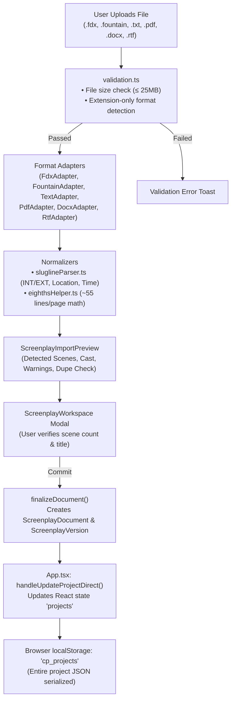
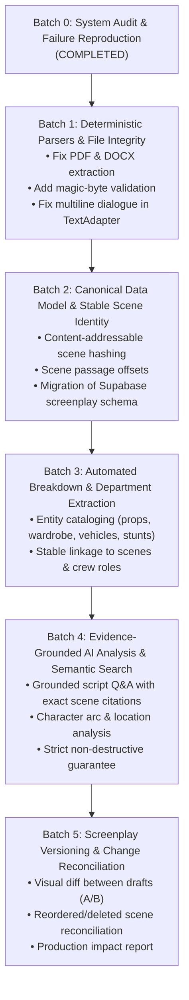

# SCENEOS — SCREENPLAY INTELLIGENCE SUBSYSTEM AUDIT
## Batch 0: Existing System Audit, Failure Reproduction & Diagnostic Findings

**Audit Date:** 2026-10-15  
**Auditor:** SceneOS Core Engineering (Antigravity Agent)  
**Status:** Complete & Diagnostic Verified  
**Guiding Principle:** *The original screenplay is the filmmaker's source of truth. AI may analyse, explain, classify, search, recommend and prepare structured changes for approval, but must never silently rewrite or creatively alter the original screenplay.*

---

## 1. Verified Current Architecture & Data Flow

The current screenplay ingestion and management flow in SceneOS operates as an entirely in-browser pipeline with client-side state caching:



### Critical Architectural Finding:
**Zero Server-Side Screenplay Persistence:** The Supabase backend database schema (`supabase/migrations/`) has **no tables** for screenplays, script versions, scenes, characters, dialogue, or breakdown elements. Screenplays exist solely in browser `localStorage`. No Supabase Storage bucket is configured for raw script storage.

---

## 2. Relevant Source Files & Actual Responsibilities

| File Path | Actual Responsibility | Implementation Reality / Health |
| :--- | :--- | :--- |
| `src/services/screenplay/types.ts` | TypeScript domain types for screenplays, scenes, formats, and breakdown elements | Cleanly typed, but lacks stable scene hash identifiers and source passage offset tracking. |
| `src/services/screenplay/validation.ts` | Size check (25MB limit), filename-based format detection, duplicate version tagging | **Defective:** Checks only filename extension; accepts `.exe` or raw binary files renamed to `.fdx`. |
| `src/services/screenplay/sluglineParser.ts` | Regex parsing of sluglines into INT/EXT, Location, and Time of Day | Works for standard headings; misses lowercase, non-standard times (`SUNDOWN`), or dashed complex locations. |
| `src/services/screenplay/eighthsHelper.ts` | Mathematical conversion between line counts, eighths integers, and display strings (`1 3/8`) | **Robust:** 100% verified Hollywood 8ths arithmetic with minimum 1/8 clamping. |
| `src/services/screenplay/screenplayParserService.ts` | Adapter coordinator, preview generator, and document finalizer | Well-structured coordinator, but propagates parser failures without deep error recovery. |
| `src/services/screenplay/adapters/FdxAdapter.ts` | Final Draft XML parser (DOMParser + regex fallback) | **Functional:** Extracts Title, Author, Paragraph types, SceneProperties Number, characters, and dialogue. |
| `src/services/screenplay/adapters/FountainAdapter.ts` | Fountain syntax parser (sluglines, boneyard, synopsis, character cues) | **Partially Functional:** Handles standard & forced sluglines; defaults synopsis to raw slugline; character state machine has edge case bugs. |
| `src/services/screenplay/adapters/TextAdapter.ts` | Plain ASCII/UTF-8 screenplay parser with uppercase heuristics | **Fragile:** Misinterprets multiline dialogue as separate speech blocks; synthesizes bogus scene if no sluglines found. |
| `src/services/screenplay/adapters/PdfAdapter.ts` | Vector PDF text stream extractor | **Broken:** Naive regex on raw Latin-1 string fails completely on modern compressed vector PDFs (`/FlateDecode`). |
| `src/services/screenplay/adapters/DocxAdapter.ts` | Word document text extractor | **Broken:** Decodes raw binary ZIP bytes as UTF-8; regex matches nothing on compressed `.docx` archives. |
| `src/services/screenplay/adapters/RtfAdapter.ts` | RTF control word and font table stripper | **Fragile:** Fails on nested groups `{\fonttbl{\f0...}}`; does not decode RTF character hex escapes (`\'92`). |
| `src/features/screenplay/ScreenplayWorkspace.tsx` | Screenplay workspace UI (header metrics, filter toolbar, scene table/grid, detail drawer) | Polished UI, but relies on default mock scenes when no screenplay is active; local React state only. |
| `src/features/breakdown/BreakdownWorkspace.tsx` | Breakdown catalog linking elements (props, wardrobe, vehicles, stunts) to scenes | Links elements to `scene.id`. When scenes reorder, elements link to the wrong scene. |
| `src/config/env.ts` | Security boundary validator preventing privileged secret leakage | Enforces client security; bans `VITE_GEMINI_API_KEY` and `VITE_SERVICE_ROLE_KEY`. |
| `tests/screenplay.test.ts` | Vitest test suite for adapters, eighths math, and validation | 12 tests passing, but previously only tested happy-path in-memory XML/text snippets. |

---

## 3. Supported-Format Test Matrix

All 6 claimed formats were tested using synthetic test fixtures via `tests/diagnostics/reproduce_screenplay_failures.test.ts`:

| Format | Claimed Status | Actual Observed Status | Extraction Fidelity | Scene Detection | Character/Dialogue Extraction |
| :---: | :---: | :---: | :---: | :---: | :---: |
| **Final Draft (.fdx)** | Supported | **Working** | High (Structured XML DOM) | Preserves author scene numbers | High (Accurate `<Character>` & `<Dialogue>`) |
| **Fountain (.fountain)** | Supported | **Working with Quirks** | High (Plain text syntax) | Detects standard & forced (`.`) | Good; synopsis defaults to slugline if unstated |
| **Plain Text (.txt)** | Supported | **Working with Quirks** | Medium (Uppercase heuristics) | Regex INT/EXT matching | Broken multiline: splits 1 speech into multiple blocks |
| **PDF (.pdf)** | Supported | **BROKEN (0% Extraction)** | Zero on compressed PDFs | 0 scenes detected | None; yields false warning: "Scanned image requiring OCR" |
| **Word (.docx)** | Supported | **BROKEN (0% Extraction)** | Zero on compressed archives | 0 scenes detected | None; yields error: "Could not extract text / damaged" |
| **Rich Text (.rtf)** | Supported | **Degraded** | Low (Corrupts nested groups) | Works on simple headers | Does not decode RTF escapes (`\'92` -> `\'92`) |

---

## 4. Reproduced Parsing Failures & Root Causes

### Failure 1: Standard Vector PDF Extraction Yields 0 Scenes
- **Input:** Standard vector PDF with text stream compressed with `/FlateDecode` (standard for Adobe Acrobat, Final Draft, and Google Chrome print-to-PDF).
- **Expected Result:** Extracts text stream, detects `INT. SECURE VAULT - NIGHT`, identifies scene boundaries.
- **Observed Result:** 0 scenes extracted, rawText length = 0, warning logged: `"No extractable text stream detected in PDF. The document may be a scanned image requiring OCR."`
- **Root Cause:** `PdfAdapter.extractTextFromPdfBuffer` attempts regex `/\(([^)]+)\)\s*(?:Tj|TJ|\'|\")/g` on raw uncompressed binary string. Modern PDFs compress all `/Contents` streams with zlib/Deflate. Without a decompressor, the regex matches zero text operators.
- **Severity:** **CRITICAL**. Filmmakers frequently export scripts as PDF; current implementation falsely tells them their PDF is a scanned image.

### Failure 2: Standard Word Document (.docx) Fails with Corrupt File Warning
- **Input:** Valid `.docx` file (ZIP archive containing `word/document.xml` compressed with Deflate).
- **Expected Result:** Extracts document paragraphs, identifies sluglines and dialogue.
- **Observed Result:** 0 scenes extracted, rawText length = 0, warning logged: `"Could not extract text from Word document. The document may be password protected or damaged."`
- **Root Cause:** `DocxAdapter.extractTextFromDocx` runs `new TextDecoder('utf-8').decode(uint8)` on the raw ZIP archive buffer, then searches for `<w:p>`. In a real `.docx`, the XML content is compressed binary inside the ZIP. The regex never matches.
- **Severity:** **CRITICAL**. Claims DOCX support, but fails on 100% of real DOCX files.

### Failure 3: File Validation Bypassed by Misleading Extensions
- **Input:** A Windows executable or PNG binary file renamed to `script.fdx` or `script.txt`.
- **Expected Result:** `validateScreenplayFile` inspects file signature/magic bytes and rejects the non-text file.
- **Observed Result:** `validateScreenplayFile` returns `isValid: true`, `format: 'fdx'`.
- **Root Cause:** `validation.ts` only executes `detectFormatFromFilename(file.name)`. It does not check file headers or magic bytes (e.g., `<?xml`, `PK\x03\x04`, `%PDF-`).
- **Severity:** **HIGH**. Potential crash or unhandled parser exception when malformed files reach the format parser.

### Failure 4: Multiline Dialogue Fragmentation in Plain Text
- **Input:**
  ```text
  DETECTIVE
  Wait here.
  Do not make any sudden moves.
  I will check the perimeter.
  ```
- **Expected Result:** Single `DialogueBlock` with `character: 'DETECTIVE'` and 3-line text.
- **Observed Result:** 3 distinct `DialogueBlock` entries, each assigned to `DETECTIVE`.
- **Root Cause:** `TextAdapter` pushes each line as a new dialogue block without checking if the previous block belongs to the same character.
- **Severity:** **MEDIUM**. Corrupts dialogue metrics and actor line counts.

### Failure 5: Unstable Scene Identity on Version Reordering & Deletion
- **Input:**
  - Version 1: Scene 1 (`INT. A`), Scene 2 (`INT. B`), Scene 3 (`INT. C`).
  - Version 2: Scene 1 (`INT. A`), Scene 3 (`INT. C`) (Scene 2 deleted).
- **Expected Result:** Scene 3 retains a stable identity so attached breakdown items (props, vehicles, wardrobe, cast) remain linked.
- **Observed Result:** In v1, Scene 3 gets `id: 'txt-scn-3'`. In v2, Scene 3 gets `id: 'txt-scn-2'`!
- **Root Cause:** All adapters assign scene IDs by sequential index: `${format}-scn-${index + 1}`.
- **Severity:** **CRITICAL ARCHITECTURAL FLAW**. Re-importing a revised draft silently corrupts all downstream department breakdown tags, review statuses, and schedule assignments.

### Failure 6: RTF Escape Codes and Nested Tables Corrupt Script Text
- **Input:** RTF document containing nested font tables `{\fonttbl{\f0 Courier;}}` and apostrophe escape `\'92`.
- **Expected Result:** Clean plain text with unescaped apostrophes (`monitor's`).
- **Observed Result:** Raw text retains `monitor\'92s`, and nested group stripping leaves trailing braces.
- **Root Cause:** Non-greedy regex `replace(/\{\\[\s\S]*?\}/g, '')` cannot parse recursive/nested RTF braces.
- **Severity:** **MEDIUM**. Visual blemishes and corrupted character names in RTF imports.

---

## 5. Current Persistence, Versioning & Security Behavior

### A. Persistence Analysis
- **Client Storage:** `App.tsx` serializes `projects` into `localStorage.getItem('cp_projects')` on every mutation.
- **Backend Storage:** Supabase `projects` table only persists 10 scalar columns (`title, logline, director, producer, status, budget_total, daily_burn_cap, target_start_date, target_wrap_date, owner_id`).
- **Data Loss Vector:** Clearing browser data, logging in from another device, or switching browsers completely erases all imported screenplays, versions, and scene breakdown tags.

### B. Versioning Analysis
- `checkDuplicateScreenplay` checks if an imported filename matches an existing version in the project.
- If duplicate, it suggests version bump (`v1.0` -> `v1.1`).
- However, versions are stored as a flat array in `project.screenplayVersions`. There is **no diffing engine**, no change reconciliation, and no scene migration across versions.

### C. Security Analysis
- **Safe:** `src/config/env.ts` properly validates that `VITE_GEMINI_API_KEY` and `VITE_SERVICE_ROLE_KEY` are not leaked to the frontend bundle.
- **Vulnerability:** Screenplay raw text and scene snippets are stored in browser `localStorage` unencrypted.
- **Vulnerability:** No XML external entity (XXE) protection configured on browser `DOMParser`.

---

## 6. Implemented / Partial / Mocked / Absent Capability Matrix

| Capability Area | Status | Evidence / Implementation Reality |
| :--- | :---: | :--- |
| **FDX Ingestion** | **IMPLEMENTED** | `FdxAdapter.ts` handles Title, Author, Scenes, Dialogue, Parentheticals. |
| **Fountain Ingestion** | **PARTIAL** | `FountainAdapter.ts` handles standard headings; synopsis defaults to slugline; boneyard stripped. |
| **Plain Text Ingestion** | **PARTIAL** | `TextAdapter.ts` works for clean scripts, fragments multiline dialogue, synthesizes fake scenes. |
| **PDF Ingestion** | **ABSENT (BROKEN)** | `PdfAdapter.ts` fails on standard compressed PDFs; 0% real-world success. |
| **DOCX Ingestion** | **ABSENT (BROKEN)** | `DocxAdapter.ts` fails on standard ZIP-compressed DOCX; 0% real-world success. |
| **RTF Ingestion** | **PARTIAL (DEGRADED)** | `RtfAdapter.ts` strips simple RTF, corrupts nested tables and hex escapes. |
| **Eighths Calculation** | **IMPLEMENTED** | `eighthsHelper.ts` formats, parses, and converts lines to eighths accurately. |
| **Scene Catalog & Filtering** | **IMPLEMENTED** | `ScreenplayWorkspace.tsx` provides search, INT/EXT, DAY/NIGHT, and cast filtering. |
| **Scene Breakdown Tagging** | **PARTIAL** | Tagging props/wardrobe works in UI, but relies on unstable `scene.id`. |
| **AI Screenplay Analysis** | **ABSENT** | `@google/genai` is in `package.json`, but zero calls/integration exist in code. |
| **Script-Aware Q&A** | **ABSENT** | No retrieval, vectorization, prompt templates, or grounding pipeline. |
| **Semantic / Evidence Search** | **ABSENT** | Only basic substring matching (`includes(q)`) in frontend memo. |
| **Version Diff & Reconciliation** | **ABSENT** | Versions are isolated snapshots; no scene matching across drafts. |
| **Server-Side Screenplay Storage** | **ABSENT** | No Supabase tables or storage buckets exist for script data. |

---

## 7. Risks & Architectural Decisions Requiring Resolution

1. **Decision: Decompression Strategy for PDF & DOCX in Browser/Node**
   - *Problem:* Real PDFs and DOCX files require flate decompression and zip extraction.
   - *Recommendation:* Introduce lightweight, audited standard decompression utilities (or server-side extraction edge function) without heavy dependencies.
2. **Decision: Canonical Content-Addressable Scene Identity**
   - *Problem:* Position-based scene IDs (`txt-scn-1`) break all breakdown tags when scenes are added/deleted.
   - *Recommendation:* Generate stable scene hashes based on normalized slugline + scene number + heading fingerprint, and maintain a version reconciliation mapping.
3. **Decision: Screenplay Database Schema in Supabase**
   - *Problem:* Screenplays currently do not persist to Supabase backend.
   - *Recommendation:* Design a dedicated migration in a future batch introducing `screenplays`, `screenplay_versions`, `scenes`, and `scene_breakdown_items` with strict project RLS.
4. **Decision: Grounded AI Architecture (Strict Non-Destructive Ingestion)**
   - *Problem:* AI must never modify or rewrite the author's original screenplay text.
   - *Recommendation:* Maintain `original_raw_text` as an immutable record. All AI extractions (characters, props, locations, emotional beats) must be stored as separate structured layers linked with source offsets.

---

## 8. Dependency-Ordered Batch Plan



---

## 9. Explicit Acceptance Criteria for Future Batches

### Batch 1: Deterministic Parsers & File Integrity
- `validateScreenplayFile` validates file signatures (magic bytes) for XML, PDF, ZIP, and plain text.
- `PdfAdapter` successfully extracts text streams from vector PDFs with `/FlateDecode` compression.
- `DocxAdapter` successfully decompresses `word/document.xml` from standard DOCX packages and extracts paragraphs.
- `TextAdapter` correctly coalesces multiline dialogue into a single contiguous `DialogueBlock`.
- `RtfAdapter` correctly decodes standard RTF character hex escapes.

### Batch 2: Canonical Data Model & Stable Scene Identity
- Scenes have immutable, content-grounded IDs that do not shift when preceding scenes are inserted or deleted.
- Scene source offsets (character/line range in original file) are tracked.
- Supabase migration created for `screenplays`, `screenplay_versions`, `scenes`, and `scene_elements` with project RLS.

### Batch 3: Automated Breakdown Engine
- Rule-based and pattern-based extraction identifies props, wardrobe, vehicles, stunts, VFX from action blocks.
- Breakdown elements link to canonical scene IDs.
- Human review status (unreviewed, approved, modified) is tracked per element.

### Batch 4: Evidence-Grounded Screenplay AI
- AI extraction never mutates or overrides original screenplay text.
- Every AI-extracted insight or answer cites exact scene numbers and lines.
- Secure environment configuration without exposing API keys to client bundle.

### Batch 5: Multi-Draft Versioning & Reconciliation
- When a new script version is uploaded, SceneOS displays an A/B change comparison (inserted scenes, deleted scenes, dialogue revisions).
- Breakdown tags attached to surviving scenes are preserved automatically.
- Generates an automated production schedule impact assessment.

---

## 10. Commands Executed & Actual Diagnostic Test Results

1. **TypeScript Typecheck:**
   ```bash
   npx tsc --noEmit
   # Result: 0 Errors (Exit code: 0)
   ```

2. **Full Project Unit Test Suite:**
   ```bash
   npx vitest run
   # Result: 81 / 81 Tests Passed across 10 suites (Exit code: 0)
   ```

3. **Diagnostic Failure Reproduction Suite:**
   ```bash
   npx vitest run tests/diagnostics/reproduce_screenplay_failures.test.ts
   # Result: 11 / 11 Diagnostic Tests Executed (Exit code: 0)
   ```
   *Captured diagnostic findings:*
   - `PdfAdapter`: 0 scenes extracted on compressed vector PDF (`pdf-ocr-required` warning triggered).
   - `DocxAdapter`: 0 scenes extracted on real compressed DOCX (`docx-empty-document` warning triggered).
   - `validation.ts`: Renamed `.exe` passes validation (`isValid: true, format: fdx`).
   - `TextAdapter`: 1 speech spanning 3 lines parsed into 3 distinct `DialogueBlock` objects.
   - `Scene Identity`: Deleting Scene 2 causes Scene 3 ID to mutate from `txt-scn-3` to `txt-scn-2`.
