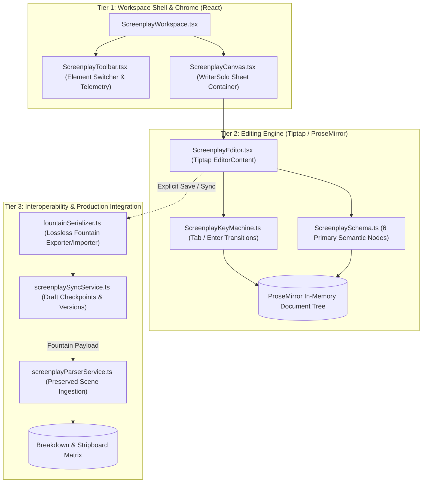
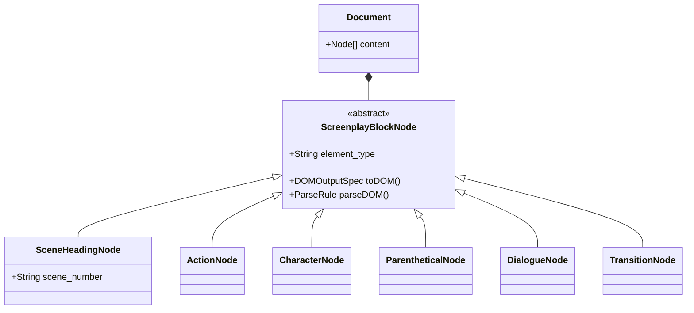
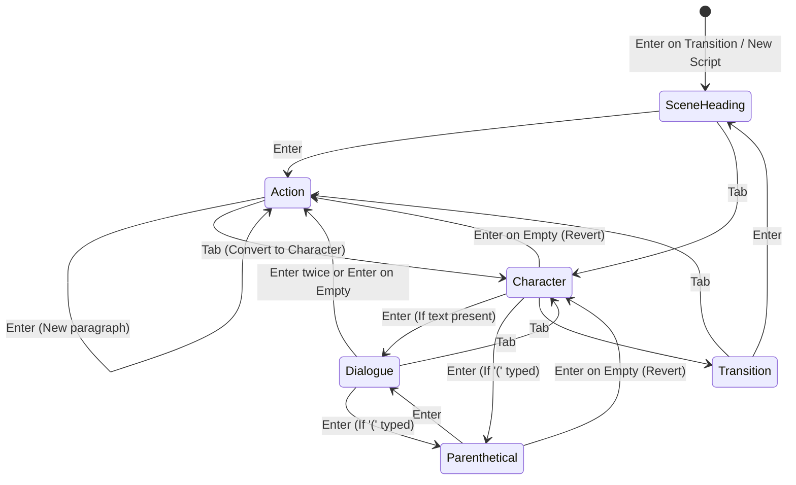
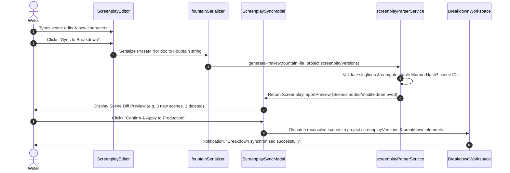

# SceneOS Screenplay — Architecture Specification
## Professional Screenwriting Engine, WriterSolo Canvas Model & Production Breakdown Integration

**Document ID:** `SCENEOS-SPEC-SCR-2026-10-18`  
**Status:** **Architectural Specification & Baseline Design** (Pre-Implementation)  
**Target Module:** `src/features/screenplay/`  
**Target Engine:** Tiptap v3 / ProseMirror with Custom Screenplay Semantic Nodes  
**Reference Standards:** WriterSolo Screenplay Canvas, Academy Nicholl Screenwriting Guidelines, US Feature & A4 International Profiles  

---

## 1. Executive Summary & Verified Current State

### 1.1 Context & Reset Background
SceneOS previously implemented a screenplay editor utilizing a monolithic plain-text string (`rawText`) in React state, synchronized with a synchronous line-by-line pagination engine (`paginationEngine.ts`). This approach caused complete browser tab freezing, severe typing lag, and caret instability due to continuous full-document line calculations and React DOM tree thrashing on keystrokes.

During **Phase 1**, all legacy editor components and synchronous pagination services were cleanly removed:
- Removed: `src/features/screenplay/ScreenplayWorkspace.tsx`, `components/ScreenplayEditor.tsx`, `components/DigitalBookshelf.tsx`, `components/ScreenplayDiffModal.tsx`, `components/ScreenplayExportModal.tsx`, `components/ScreenplayTitlePageModal.tsx`, and `components/FutureSubmodulePlaceholder.tsx`.
- Removed: `src/services/screenplay/paginationEngine.ts`, `formattingProfile.ts`, `screenplayExporter.ts`, and `diffHelper.ts`.
- Removed: 9 obsolete test suites testing the deleted line-level DOM nodes.

### 1.2 Current Baseline in Repository (Verified Facts)
- **Active Navigation & Mount**: In `src/App.tsx` (lines 2984–2997), when `workspaceTab === 'screenplay'` and `activeProject` is loaded, the application mounts a lightweight offline placeholder (`#workspace-screenplay-content`). In `src/components/navigation/AppSidebar.tsx` and `navigationHierarchy.ts`, the Screenplay tab is registered with an `Offline` badge. It mounts in **~430ms** with zero freeze and zero console errors.
- **Installed Editor Dependencies**: In `package.json` and `node_modules`, the Tiptap/ProseMirror foundation packages are installed:
  - `@tiptap/react`: `^3.32.0`
  - `@tiptap/pm`: `^3.32.0`
  - `@tiptap/starter-kit`: `^3.32.0`
- **Current File Tree**: `src/features/screenplay/` exists with an empty `components/` subfolder. No editor code, hooks, or schemas have been implemented yet.
- **Preserved Core Services**: In `src/services/screenplay/`, shared parsing and ingestion services remain fully functional:
  - `screenplayParserService.ts` (multi-format ingestion coordinator)
  - `eighthsHelper.ts` (Hollywood 1/8th page math and line estimates)
  - `sluglineParser.ts` (scene heading decomposition into Int/Ext, Location, Time of Day)
  - `sceneIdentityService.ts` (MurmurHash3 deterministic scene ID hashing and draft reconciliation)
  - `validation.ts` (format detection and magic-byte integrity)
  - `adapters/` (FDX, Fountain, Text, RTF, PDF, DOCX adapters)
- **Shared Data Models**: In `src/types.ts`, `FilmProject.screenplayVersions?: ScreenplayVersion[]` defines draft versioning with fields: `id`, `version`, `title`, `author`, `updatedAt`, `changeDescription`, `status`, `scenes`, `rawText`, and `titlePageMetadata`.

---

## 2. Architecture & Component Hierarchy

### 2.1 Separation of Concerns
The new architecture divides the screenplay domain into three strictly isolated tiers:
1. **Editing Surface Tier**: Fast, schema-driven ProseMirror document managed by Tiptap. High-frequency operations (typing, caret, formatting) remain completely decoupled from React component renders.
2. **Workspace Chrome Tier**: WriterSolo-inspired visual canvas, dark surround, zoom controls, active element toolbar, and save telemetry.
3. **Downstream Production Tier**: Conversion of the active document into Fountain text, feeding `screenplayParserService` only upon explicit user save or sync action to update `BreakdownWorkspace`.



### 2.2 Proposed Component Hierarchy & File Responsibilities

| File Path | Responsibility | State Managed |
| :--- | :--- | :--- |
| `src/features/screenplay/ScreenplayWorkspace.tsx` | Main workspace container mounted by `App.tsx`. Handles draft switching, save status, and breadcrumbs. | Active draft ID, save status ('Saved' \| 'Saving' \| 'Unsaved'), document statistics. |
| `src/features/screenplay/components/ScreenplayToolbar.tsx` | Compact, horizontal toolbar docked above canvas. Displays active element tag, element switch buttons, zoom, and Sync button. | Active node type at caret, zoom level (85%–130%). |
| `src/features/screenplay/components/ScreenplayCanvas.tsx` | Visual paper container simulating portrait page sheet (WriterSolo model). Houses CSS page boundaries. | Page size setting (A4 vs US Letter), visual zoom transform. |
| `src/features/screenplay/components/ScreenplayEditor.tsx` | Tiptap `EditorContent` wrapper. Manages editor instance lifecycle (`useEditor`, `editor.destroy()`). | Focus state, selection change subscriptions. |
| `src/features/screenplay/schema/ScreenplaySchema.ts` | ProseMirror node definitions for the 6 primary screenplay blocks with exact attribute validation. | Node specifications, parsing and serialization rules. |
| `src/features/screenplay/extensions/ScreenplayKeyMachine.ts` | Dual-key keyboard navigation (Tab / Enter / Backspace) implementing industry screenwriting rules. | Keymap plugin intercepting Enter, Tab, Shift+Tab, Backspace. |
| `src/features/screenplay/services/fountainSerializer.ts` | Bidirectional converter between ProseMirror doc JSON and standard Fountain plain-text. | Lossless text translation without DOM access. |
| `src/features/screenplay/components/ScreenplaySyncModal.tsx` | Confirmation modal comparing edited script changes against current Breakdown scenes before updating production. | Diff preview, scene reconciliation flags. |

---

## 3. Screenplay Semantic Document Model

### 3.1 ProseMirror Document Schema
Rather than generic HTML elements (`<p>`, `<h1>`, `<div>`), the editor uses dedicated, semantic ProseMirror block nodes. Each node represents exactly one screenplay element.



#### Node Definitions:
1. **`scene_heading`**:
   - *Content*: `inline*` (plain text only; no marks).
   - *Group*: `block`.
   - *Attributes*: `scene_number` (optional string, e.g. "1", "2A").
   - *DOM Representation*: `<div data-element="scene-heading" class="screenplay-scene-heading uppercase font-bold">...</div>`.
   - *Behavior*: Always auto-capitalized.
2. **`action`** *(Default block element)*:
   - *Content*: `inline*` (supports standard italic/bold marks if permitted, plain by default).
   - *Group*: `block`.
   - *DOM Representation*: `<div data-element="action" class="screenplay-action">...</div>`.
3. **`character`**:
   - *Content*: `inline*`.
   - *Group*: `block`.
   - *DOM Representation*: `<div data-element="character" class="screenplay-character uppercase">...</div>`.
   - *Behavior*: Always auto-capitalized. Must precede dialogue or parenthetical.
4. **`parenthetical`**:
   - *Content*: `inline*`.
   - *Group*: `block`.
   - *DOM Representation*: `<div data-element="parenthetical" class="screenplay-parenthetical">...</div>`.
   - *Behavior*: Formatted with enclosing parentheses.
5. **`dialogue`**:
   - *Content*: `inline*`.
   - *Group*: `block`.
   - *DOM Representation*: `<div data-element="dialogue" class="screenplay-dialogue">...</div>`.
6. **`transition`**:
   - *Content*: `inline*`.
   - *Group*: `block`.
   - *DOM Representation*: `<div data-element="transition" class="screenplay-transition uppercase text-right">...</div>`.
   - *Behavior*: Right-aligned, auto-capitalized.

### 3.2 Dual-Key Machine (Tab / Enter State Machine)
The core productivity of a screenplay editor relies on predictable, muscle-memory transitions when hitting `Enter` or `Tab`.



#### Detailed Transition Rules:
- **From `scene_heading`**:
  - `Enter`: Creates a new `action` block immediately below.
  - `Tab`: Converts current line to `character`.
- **From `action`**:
  - `Enter`: Creates a new `action` paragraph.
  - `Tab` (at beginning or on empty line): Converts block to `character`.
- **From `character`**:
  - `Enter` (with text): Creates a `dialogue` block immediately below.
  - `Enter` (if empty): Reverts block to `action`.
  - `Tab`: Cycles to `transition`.
- **From `parenthetical`**:
  - `Enter`: Creates a `dialogue` block immediately below.
  - `Backspace` (on empty): Reverts to `dialogue` or `character`.
- **From `dialogue`**:
  - `Enter` (with text): Creates a new `dialogue` block or line; pressing `Enter` again on empty line converts to `action`.
  - `Tab`: Converts next line to `character` (for fast dialogue back-and-forth).
- **From `transition`**:
  - `Enter`: Creates a `scene_heading` block immediately below.
  - `Tab`: Cycles to `action`.
- **Backspace Behavior**:
  - Pressing `Backspace` at position 0 of an empty element reverts the block to `action` rather than immediately merging with previous node, preventing accidental destructive joins.

---

## 4. Screenplay Formatting & Canvas Architecture

### 4.1 Visual Canvas (WriterSolo Inspiration)
- **Surrounding Workspace**: Dark neutral substrate (`bg-[#0B0E17]` or `bg-zinc-950`). Distraction-free, high visual ergonomics for extended writing.
- **Document Container**: Centered, portrait-oriented white sheet (`#FFFFFF`) with a subtle elevated shadow (`shadow-2xl`) and hairline border (`border-zinc-300`).
- **Dimensions**:
  - **A4 Profile (Default)**: Width `210mm` (~794px at 96 DPI), Height `297mm` (~1123px at 96 DPI).
  - **US Letter Profile (Nicholl)**: Width `8.5in` (816px at 96 DPI), Height `11.0in` (1056px at 96 DPI).
- **Typography**:
  - Font Family: `Courier Prime`, monospace (with fallbacks `Courier New`, `Courier`).
  - Font Size: Exactly `12pt` (`16px`).
  - Pitch: `10 CPI` (10 characters per inch; fixed monospace grid).
  - Line Height: `1.2` (`14.4pt` / `19.2px`), standard 6 lines per inch (LPI).

### 4.2 Element Margin & Indentation Matrix
To guarantee standard layout conforming to Nicholl and Writers Guild conventions, margins are applied as CSS padding/margins relative to the page sheet's left edge (1.5 inches / 144px binding margin):

| Element | Left Offset (from Paper Edge) | Right Margin | Text Transform | Alignment | Spacing Before |
| :--- | :---: | :---: | :---: | :---: | :---: |
| **Scene Heading** | **1.5 in** (144px) | 1.0 in (96px) | Uppercase | Left | 2 lines (24pt) |
| **Action** | **1.5 in** (144px) | 1.0 in (96px) | Normal | Left | 1 line (12pt) |
| **Character** | **3.7 in** (355px) | 1.0 in (96px) | Uppercase | Left-aligned cue | 1 line (12pt) |
| **Parenthetical** | **3.1 in** (298px) | 2.5 in (240px) | Normal | Left-indented | 0 lines |
| **Dialogue** | **2.5 in** (240px) | 2.0 in (192px) | Normal | Left-indented | 0 lines |
| **Transition** | **6.0 in** (576px) | 1.0 in (96px) | Uppercase | Right | 1 line (12pt) |

---

## 5. Pagination Architecture Decision

### 5.1 Analysis of Approaches

| Approach | Description | Typing Latency | Implementation Complexity | Correctness & Export Match | Verdict |
| :--- | :--- | :---: | :---: | :---: | :--- |
| **1. Synchronous DOM/Text Slicing (Deleted Architecture)** | Split text into lines, calculate line counts, render individual React nodes for each line across virtual page cards. | **Unacceptable** (500ms–2000ms, causes browser freeze) | Extremely high (virtualization, DOM syncing) | Flawed (split caret across nodes) | **Rejected** |
| **2. Continuous Canvas with CSS Page-Break Simulation (WriterSolo/Docs Model)** | Single unified ProseMirror contenteditable container. Pages are rendered visually using CSS background dividers, or an asynchronous measurement pass marks page-break decorations. | **Instantaneous** (0–5ms input latency, 60 FPS) | Moderate (ProseMirror decoration plugin) | High (matches standard web word processors) | **Recommended** |
| **3. True Dual-Pass WebWorker Pagination** | Background worker computes line heights and dispatches page-break offsets to a ProseMirror plugin. | **Excellent** (Off main thread) | High (worker communication & serialization) | Very High | **Future Enhancement** |

### 5.2 Recommended Decision: Continuous Canvas with Async Page Breaks
1. **Single Contenteditable Root**: The writer types uninterrupted inside a single ProseMirror container. The cursor is never destroyed, detached, or transferred across artificial page boundaries.
2. **Asynchronous Visual Page Breaks**: A lightweight ProseMirror Plugin (`ScreenplayPaginationPlugin`) monitors document height using a debounced `ResizeObserver` (or line-height tally of 54 lines/page). When a page boundary is crossed, a decorative widget node (`PageBreakWidget`) is inserted at the block boundary displaying a page gap line and running header (`Page 2.`).
3. **Orphan Heading Suppression**: If a `scene_heading` or `character` node falls within the final 2 lines of a page, the decoration breaks before the heading, pushing it to the next page.
4. **Print / PDF CSS**: Standard `@media print` rules:
   ```css
   @page {
     size: A4 portrait;
     margin: 1.0in 1.0in 1.0in 1.5in;
   }
   .screenplay-scene-heading {
     break-after: avoid;
     page-break-after: avoid;
   }
   .screenplay-character {
     break-after: avoid;
     page-break-after: avoid;
   }
   ```

---

## 6. State Management, Persistence & Recovery

### 6.1 State Separation Matrix
To prevent data loss and UI freezes, data states are strictly decoupled:

```
[ ProseMirror In-Memory State ] (Ephemeral, 60fps typing)
              │
              ▼ (Debounced Autosave: 1500ms)
[ Screenplay Working Copy ] (localStorage: 'sceneos_script_draft_{projectId}')
              │
              ▼ (Explicit User Checkpoint / Version Lock)
[ FilmProject.screenplayVersions[] ] (Project Store & Supabase Cloud)
              │
              ▼ (Explicit "Sync to Breakdown" Action)
[ screenplayParserService -> Breakdown Matrix ] (Production Schedules)
```

### 6.2 Persistence & Recovery Workflow
1. **Live State**: Managed exclusively by Tiptap's internal `EditorState`.
2. **Local Session Cache**: On document transaction, a debounced handler (1500ms) serializes the doc to Fountain text and stores it in `localStorage.setItem('sceneos_script_draft_' + projectId, fountainText)`.
3. **Dirty State & Window Protection**: If edits exist that are not committed to `FilmProject`, `beforeunload` is registered to prevent accidental browser tab closure.
4. **Project State Commit**: When the writer clicks "Save Draft" or creates a version checkpoint:
   - Increments version number (e.g. `v1.0` -> `v1.1`).
   - Appends to `activeProject.screenplayVersions`.
   - Calls `onUpdateProject(updatedProject)`.
   - Persists through SceneOS's existing persistence layer (`cp_projects` in `localStorage` and `SupabaseProjectService`).

---

## 7. Breakdown Integration Boundary & Contract

### 7.1 Integration Principle
The editor **must never directly mutate** `activeProject.phases` or the breakdown matrix while the author is actively writing. Breaking down scenes requires an explicit confirmation step.

### 7.2 The 5-Step Synchronization Pipeline



### 7.3 Edge Case & Ambiguity Handling
- **Scene Number Stability**: Scene IDs are derived using MurmurHash3 hashing on normalized sluglines (`sceneIdentityService.ts`). Re-ordering scenes or inserting Scene 2A preserves Scene 1's ID and all its tagged props/cast.
- **Duplicate Sluglines**: If two identical sluglines exist (e.g. `INT. OFFICE - DAY` twice), `sceneIdentityService` tracks occurrence index (`INT. OFFICE - DAY #2`) to prevent element collision.
- **Deleted Scenes**: If a scene is removed in the editor, the sync modal warns the user that production breakdown items for that scene will be archived, requiring explicit acknowledgment.

---

## 8. File Interoperability Matrix

| Format | Import Support | Export Support | Engine / Service | Notes |
| :--- | :---: | :---: | :--- | :--- |
| **SceneOS Native (Fountain)** | **Yes** | **Yes** | `fountainSerializer.ts` | Primary interchange format. Lossless, human-readable plain text. |
| **Final Draft (.fdx)** | **Yes** | Planned (Phase 3) | Preserved `FdxAdapter.ts` | Imports XML scenes, characters, and dialogue into editor. |
| **Plain Text (.txt)** | **Yes** | **Yes** | Preserved `TextAdapter.ts` | Auto-detects sluglines and indentations. |
| **PDF Document (.pdf)** | Import only (Ingest) | Planned | Preserved `PdfAdapter.ts` / Browser Print | Export initially handled via standard CSS print-to-PDF. |

---

## 9. Performance & Reliability Acceptance Criteria

| Metric | Target | Measurement Method | Failure Threshold |
| :--- | :--- | :--- | :--- |
| **Initial Mount Time** | **< 400ms** | Chrome CDP performance timing (`Date.now()` delta on mount) | > 800ms |
| **Keystroke Input Latency** | **< 16ms** (60 FPS) | Performance profile during rapid 100-character input stream | > 50ms (noticeable stutter) |
| **Workspace Switching Latency** | **< 300ms** | Navigation from Overview -> Screenplay -> Breakdown and back | > 600ms |
| **Feature-Length Document (110 Pages / ~25,000 words)** | **Smooth scrolling & typing** | Load 110-page sample script via Tiptap transaction | Main thread lockup > 100ms |
| **Large Paste Operation (10+ pages)** | **< 500ms** | Paste 10 pages of script text | Tab freeze or memory spike |
| **Memory Cleanup on Unmount** | **0 Leaks** | `editor.destroy()` called in `useEffect` cleanup; heap snapshot stable | Detached DOM nodes retained |
| **Browser Console Errors** | **0 Errors** | DevTools console monitoring during editing and tab transitions | Any unhandled exception |

---

## 10. Phased Implementation Roadmap

```mermaid
gantt
    title SceneOS Screenplay Phased Implementation Plan
    dateFormat  X
    axisFormat %s

    section Phase 1: Engine Foundation
    Milestone A - Tiptap Foundation & Shell           :active, m1, 0, 1
    Milestone B - Screenplay Schema & Dual-Key       :m2, after m1, 1

    section Phase 2: WriterSolo Experience
    Milestone C - Canvas & Element Toolbar           :m3, after m2, 1
    Milestone D - Visual Pagination & Sheet Flow     :m4, after m3, 1

    section Phase 3: Production Integration
    Milestone E - Persistence & Draft Recovery       :m5, after m4, 1
    Milestone F - Breakdown Sync & Ingestion Handoff :m6, after m5, 1
```



### Milestone A: Tiptap Foundation & Workspace Shell
- **Single Objective**: Mount a clean, isolated Tiptap editor in `ScreenplayWorkspace` with zero freeze and fast unmounting.
- **Scope**:
  - `src/features/screenplay/ScreenplayWorkspace.tsx`
  - `src/features/screenplay/components/ScreenplayEditor.tsx`
  - Replace offline placeholder in `src/App.tsx`.
  - Add "Blank Document" and "Load Dev Sample" controls.
- **Out of Scope**: Custom screenplay element schemas, dual-key typing machine, PDF export.
- **Dependencies**: `@tiptap/react`, `@tiptap/starter-kit`, `@tiptap/pm` (already installed).
- **Verifiable Acceptance Criteria**:
  - Screenplay tab mounts in <400ms with zero console errors.
  - User can type freely with immediate caret responsiveness.
  - Navigating to Breakdown and returning unmounts and remounts cleanly.
- **Primary Technical Risk**: React 19 compatibility with Tiptap editor event dispatching.

### Milestone B: Screenplay Semantic Schema & Dual-Key Machine
- **Single Objective**: Implement the 6 primary screenplay nodes and dual-key keyboard shortcuts (Tab / Enter).
- **Scope**:
  - `src/features/screenplay/schema/ScreenplaySchema.ts`
  - `src/features/screenplay/extensions/ScreenplayKeyMachine.ts`
- **Out of Scope**: Page geometry, visual toolbar.
- **Dependencies**: Milestone A.
- **Verifiable Acceptance Criteria**:
  - Enter from `character` transitions to `dialogue`.
  - Enter from `scene_heading` transitions to `action`.
  - Tab from `action` transitions to `character`.
  - Auto-capitalization enforced on sluglines and characters.
- **Primary Technical Risk**: ProseMirror keymap conflict with standard browser text navigation.

### Milestone C: WriterSolo Canvas & Element Toolbar
- **Single Objective**: Implement the WriterSolo visual canvas and compact element selector toolbar.
- **Scope**:
  - `src/features/screenplay/components/ScreenplayCanvas.tsx`
  - `src/features/screenplay/components/ScreenplayToolbar.tsx`
  - Styling for A4/Letter margins, 12pt Courier typography, and exact element indentations.
- **Out of Scope**: Physical page breaks, PDF export.
- **Dependencies**: Milestone B.
- **Verifiable Acceptance Criteria**:
  - Screenplay paper rendered as a centered white portrait sheet with dark surrounding workspace.
  - Active element displayed in toolbar updates automatically as caret moves between elements.
  - Clicking toolbar element converts active block.
- **Primary Technical Risk**: CSS layout overflow on smaller viewports.

### Milestone D: Continuous Visual Pagination
- **Single Objective**: Provide visual page break indicators and running page headers without performance degradation.
- **Scope**:
  - `src/features/screenplay/extensions/ScreenplayPaginationPlugin.ts`
  - Page break styling and running header formatting.
- **Out of Scope**: Complex print driver bindings.
- **Dependencies**: Milestone C.
- **Verifiable Acceptance Criteria**:
  - Page breaks appear cleanly at ~54 lines; typing near boundaries remains at 60 FPS.
  - Orphan headings automatically pushed to the next page sheet.
- **Primary Technical Risk**: Inaccurate line-height calculation across browser font-rendering engines.

### Milestone E: Document Persistence & Version Checkpoints
- **Single Objective**: Enable local draft recovery and save checkpoints to `FilmProject.screenplayVersions`.
- **Scope**:
  - `src/features/screenplay/services/fountainSerializer.ts`
  - `src/features/screenplay/services/screenplayPersistence.ts`
  - Save status indicator (`Saved`, `Saving`, `Unsaved`).
- **Out of Scope**: Breakdown sync.
- **Dependencies**: Milestone C.
- **Verifiable Acceptance Criteria**:
  - Refreshing the browser restores unsaved edits from localStorage.
  - Clicking "Save Version" appends a new draft to `activeProject.screenplayVersions`.
- **Primary Technical Risk**: Race condition between debounced autosave and page navigation.

### Milestone F: Breakdown Integration & Ingestion Synchronization
- **Single Objective**: Seamlessly sync edited screenplay drafts into `BreakdownWorkspace`.
- **Scope**:
  - `src/features/screenplay/components/ScreenplaySyncModal.tsx`
  - Wire editor export into `screenplayParserService.generatePreview()`.
- **Out of Scope**: Real-time collaborative multi-user locking.
- **Dependencies**: Milestone E.
- **Verifiable Acceptance Criteria**:
  - Clicking "Sync to Breakdown" opens preview modal showing detected scene changes.
  - Confirming updates `activeProject.phases` and breakdown elements without data corruption.
- **Primary Technical Risk**: Misidentifying reordered scenes causing tag misassociation.

---

## 11. Key Decisions, Unresolved Trade-offs & Recommendations

| Item | Architectural Dilemma | Recommended Resolution |
| :--- | :--- | :--- |
| **Default Page Format** | A4 (International) vs US Letter (Nicholl / US Feature). | **Default to A4** for international flexibility while providing an instant toggle in the canvas header to switch to **US Letter**. Both share the identical 1.5" binding margin. |
| **Undo / Redo History** | ProseMirror `history` vs React state snapshots. | **Use ProseMirror `history` plugin exclusively**. It records fine-grained transaction steps and prevents full-document React re-renders. |
| **PDF Export Strategy** | Heavy client-side PDF renderer (`jspdf` / `pdfmake`) vs Native Browser Print CSS. | **Milestone 1–4 uses native `@media print` styling** with zero bundle overhead. Advanced vector PDF exporter deferred to post-MVP. |
| **Fountain Parser Integration** | Write a new Fountain parser vs reuse `FountainAdapter.ts`. | **Reuse `src/services/screenplay/adapters/FountainAdapter.ts`** with a lightweight serializer in `fountainSerializer.ts` for clean two-way interchange. |

---

## 12. Recommended First Implementation Task

### **Milestone A: Minimal Tiptap Foundation & Isolated Workspace Shell**
The immediate next step is to build Milestone A:
1. Create `src/features/screenplay/components/MinimalScreenplayEditor.tsx` using Tiptap's `useEditor` and standard `StarterKit`.
2. Create `src/features/screenplay/ScreenplayWorkspace.tsx` with a clean workspace header, "Blank Document" button, and "Load Sample (Dev)" button.
3. Update `src/App.tsx` to mount `<ScreenplayWorkspace />` in place of the current offline placeholder.
4. Verify via headless Chrome CDP that the workspace mounts in <400ms, typing is instantaneous, and navigating between workspaces produces zero freezes.
